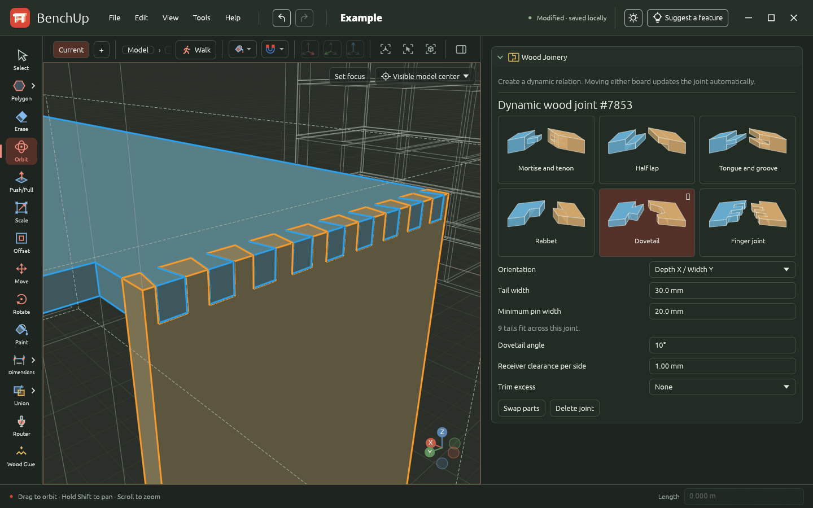
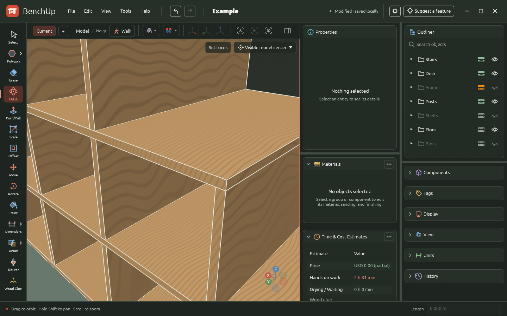
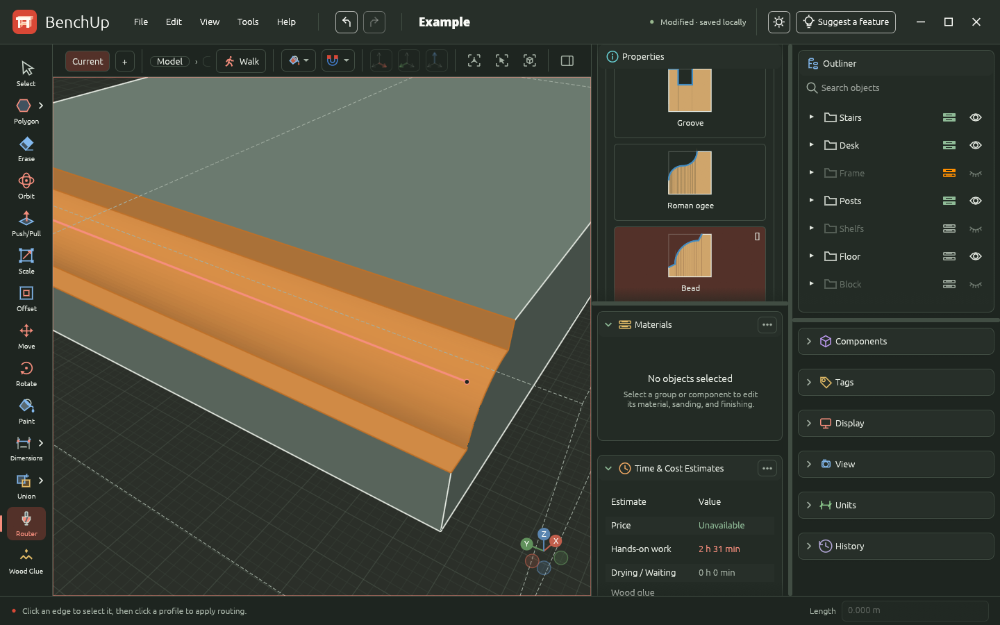
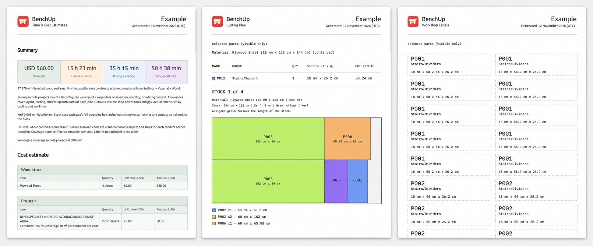

# BenchUp


[](https://benchup3d.github.io/editor/play/)

## Download for desktop

[](https://github.com/BenchUp3D/editor/releases/latest/download/io.github.BenchUp3D.BenchUp-win-x64-Setup.exe)
[](https://github.com/BenchUp3D/editor/releases/latest/download/io.github.BenchUp3D.BenchUp-osx-arm64-Setup.pkg)
[](https://github.com/BenchUp3D/editor/releases/latest/download/io.github.BenchUp3D.BenchUp-osx-x64-Setup.pkg)
[](https://github.com/BenchUp3D/editor/releases/latest/download/io.github.BenchUp3D.BenchUp-linux-x64.AppImage)
[](https://github.com/BenchUp3D/editor/releases/latest)

A free, open-source 3D modeling app for woodworking and furniture design, written in Rust. Plan individual boards, wood joints, and complete assemblies with exact measurements before heading to the workshop. The same editor runs as a native Windows, macOS, or Linux application and in a desktop browser through WebAssembly.

The workspace includes Select, Line, Rectangle, Circle, Polygon, Freehand, Push/Pull, Scale, Offset, Move, Rotate, Paint, Tape Measure, Protractor, Dimensions, a Union flyout, Router, Erase, and Orbit, automatic geometry snapping, filled planar faces, measured lines, full-enclosure box selection, groups and components, a right-click object menu, geometry clipboard, undo/redo, local autosave, and portable `.bup` project files, with support for legacy `.k3d` and `.ketchup` projects. It starts with an empty model. File → Import/Export adds SketchUp `.skp` import and Wavefront `.obj` export. Mobile and cloud storage are outside this version.

## Woodworking features

Model shelves, tables, cabinets, workbenches, and other furniture with precisely sized parts. Use groups, reusable components, and tags to keep the assembly organized, then inspect dimensions and fit from any angle. Measure three points with Protractor to place a persistent angle dimension automatically. The arc and label are saved in the project and follow attached geometry.

### Wood joinery

Create mortise-and-tenon, half-lap, tongue-and-groove, rabbet, dovetail, and finger joints between boards, including angled connections. Adjust joint dimensions and clearance with live previews. Dynamic joints update automatically when either board moves. Inspect machining diagnostics and cut guides, and trim excess material past a joint while keeping the original boards editable.



### Procedural wood material

Set the grain direction on groups and components and show grain-direction guides directly on the model. Review how the grain runs across each board and through the full assembly before building. Grain orientation is saved with the project and follows the parts when they rotate.

In the Materials face style, parts with assigned wood stock show procedural grain and the result of their sanding and finishing steps. Set the wood color and product appearance in the material catalog, then adjust the recipe and appearance overrides in the part's inspector. Work rates and drying times affect estimates only. Explicit face colors and Color by Tag take precedence over the finish preview.



### Router tool

Select an edge with Router, then choose a profile in Properties to apply it immediately. Shape edges with chamfer, bevel, roundover, cove, rabbet, groove, Roman ogee, and bead profiles. Adjust the profile dimensions, change it later, or choose None to remove routing while preserving the original stock. Lines drawn on a solid face can also define routing paths. Saved routes contribute their length and work time to project estimates.



### Plan materials and workshop work

Assign stock materials and wood types to parts, configure sanding and finishing products, and prepare cut lists, cutting plans, and workshop labels. Export cutting plans and time and cost estimates to PDF to take the design into the workshop.

### PDF exports

Use the Tools menu to turn the model into printable workshop documents. Each report includes the BenchUp header, project name, and generation date.



- **Time & Cost Estimates** summarizes material costs, hands-on work, drying and waiting time, and the sequential total. Detailed tables break down stock and finishing supplies, workshop tasks, and joinery allowances. Use it to plan purchases and time; labor is not included in the material price.
- **Cutting Plan** groups matching parts by material and size, lists quantities and finished cutting dimensions, and lays out marked parts on the selected stock. Color-coded diagrams show part placement, saw kerf, and offcuts, with grain direction and rotation settings taken into account. Parts that do not fit the stock are flagged separately.
- **Workshop Labels** creates one printable label per piece, with the part mark, group or component name, and dimensions. Cut along the dotted borders and attach the labels to keep similar boards identifiable during assembly. The marks match those in the cutting plan.

Cutting plans and labels can cover selected parts or all visible parts in the project. Assign stock materials to the parts first, and verify dimensions before cutting.

## Documentation

This README covers developer installation, building, verification, and deployment.
For instructions on using BenchUp, see the [user documentation](docs/README.md).

## Prerequisites

- Rust installed with rustup. `rust-toolchain.toml` pins Rust 1.97.1 for development and CI; the workspace minimum supported version is 1.95.
- A C/C++17 compiler for the native SketchUp reader (GCC/Clang on Linux, Xcode Clang on macOS, or MSVC on Windows). Browser builds do not require it.
- A GPU/driver supported by wgpu. The browser prefers WebGPU and falls back to WebGL2.
- On Linux, development libraries for X11/Wayland, xkbcommon, and libudev. For Debian/Ubuntu: `sudo apt install build-essential pkg-config libx11-dev libxcb1-dev libxkbcommon-dev libwayland-dev libegl1-mesa-dev libudev-dev`.
- On Windows, the MSVC Rust toolchain and Visual Studio Build Tools with the **Desktop development with C++** workload and a Windows SDK. SpaceMouse support uses Windows system APIs; no separate HIDAPI or libusb installation is required.
- On macOS, Xcode Command Line Tools (`xcode-select --install`), including Clang and the macOS SDK. SpaceMouse support uses the system IOKit, CoreFoundation, and AppKit frameworks; no Homebrew HIDAPI or libusb package is required.

Linux desktop builds use libudev through the `hidapi` dependency to discover SpaceMouse devices. The `libudev-dev` package supplies the headers and `pkg-config` metadata needed to compile this support, even if no SpaceMouse is connected. If compilation fails with `Unable to find libudev` or `Package 'libudev' not found`, install `libudev-dev` and retry. Browser builds do not use `hidapi`. See the upstream [HIDAPI build prerequisites](https://github.com/libusb/hidapi/blob/master/BUILD.md#prerequisites).

## Run on desktop

```sh
cargo run -p benchup-app --profile dev-desktop
```

The `dev-desktop` profile enables incremental application compilation for faster
rebuilds after edits. It preserves the usual development optimizations, full debug
symbols, debug assertions, and overflow checks. The executable is
`target/dev-desktop/benchup-app` (`benchup-app.exe` on Windows).

To rebuild and relaunch automatically after changes, install a
[prebuilt Watchexec executable](https://github.com/watchexec/watchexec/releases)
and put it on your `PATH`, then run from the repository root:

```sh
watchexec --restart --debounce 1s --shell none \
  --watch crates --watch assets --watch Cargo.toml --watch Cargo.lock \
  -- cargo run -p benchup-app --profile dev-desktop --locked
```

This watches all workspace crates (including native reader sources and shaders),
embedded assets, and dependency manifests. Saves within one second are grouped
into one restart. Build output stays in the terminal; after a compilation error,
the watcher retries on the next edit. Stop it with Ctrl+C. Each restart terminates
the current app process, so save model edits before changing source files; only
persisted state survives. This command watches application inputs; restart it
manually after changing `.env`, Cargo configuration, or the Rust toolchain.

On Linux, register the application launcher and icons once after compiling:

```sh
python3 scripts/install_linux_desktop.py target/dev-desktop/benchup-app
```

This installs into your user data directory (`$XDG_DATA_HOME`, or `~/.local/share`) without root access. GNOME on Wayland uses the application's ID and matching desktop entry to find its icon. Restart BenchUp after installing. The launcher points to the executable you pass, so later compilations with the same profile update it. For a release installation, pass its path: `python3 scripts/install_linux_desktop.py target/release/benchup-app`. Keep that executable in place, or rerun the installer with its new path if you move it. Omitting the path still selects `target/debug/benchup-app` for the standard `dev` profile.

## Run in a browser

Install the browser target and Trunk once:

```sh
rustup target add wasm32-unknown-unknown
cargo install --locked trunk
```

From the repository root:

```sh
trunk serve
```

Open <http://127.0.0.1:8080>. Keep the app on the same origin/port to restore the same saved model. No Node.js, JavaScript application framework, or backend is required. Trunk generates the JavaScript needed to load the Rust WebAssembly program.

Development builds use light optimization for application code and stronger optimization for dependencies and the geometry core, on both desktop and WebAssembly. Debug symbols, debug assertions, and overflow checks remain enabled. These optimizations target the cost of menu hovering, scrolling, and rendering in debug mode. The profile takes effect on the next development compilation; changing it recompiles affected dependencies once.

`trunk serve` continues to use the standard `dev` profile, which disables
incremental compilation for `benchup-app` to avoid a WebAssembly linker issue.
Use `dev-desktop` only for native development. Its first build populates a
separate target directory; later edits reuse that profile's compilation artifacts.

The workspace keeps geometry formats and the embedded browser SketchUp reader
in `benchup-io`, with the C/C++ reader and its safe Rust boundary in `benchup-skp`.
The application depends on these crates, so UI edits reuse their compiled
artifacts. The native reader compiles C/C++ files in parallel and no
longer rebuilds when application server or update configuration changes.

## Compile for distribution

Desktop, on the OS you want to target:

```sh
cargo build -p benchup-app --release --locked
```

The executable is `target/release/benchup-app` (`benchup-app.exe` on Windows). These commands produce executables, not installers or signed application bundles. Native builds should run on the corresponding OS; this project does not configure cross-linkers or signing identities.

### Automated release builds

[Build releases](.github/workflows/build.yml) runs when a `v*` tag is pushed
(for example, `git push origin v0.1.0`). The tag must be a stable `vX.Y.Z`
version matching `[workspace.package].version` in `Cargo.toml`. It builds with
the pinned Rust toolchain and committed `Cargo.lock`, runs update regression
tests, and packages the desktop app with Velopack and the browser app with Trunk:

| Artifact | Platform | Install / run |
|---|---|---|
| `benchup-windows-x64` | Windows x64 (MSVC) | `*-win-x64-Setup.exe` (per-user installer) |
| `benchup-macos-arm64` | macOS Apple Silicon | `*-osx-arm64-Setup.pkg` or the portable `.app` zip |
| `benchup-macos-x64` | macOS Intel (x64) | `*-osx-x64-Setup.pkg` or the portable `.app` zip |
| `benchup-linux-x64` | Linux x64 (built on Ubuntu 22.04) | `*-linux-x64.AppImage` |
| `benchup-wasm` | Desktop browsers (WebAssembly) | Extract `benchup-vX.Y.Z-wasm.zip` and serve it with a static web server |

The macOS builds run natively on `macos-15` (Apple Silicon) and
`macos-15-intel` (Intel). Both target macOS 11.0 or newer and use the same
signing and notarization secrets, with separate `osx-arm64` and `osx-x64`
update channels.

[Warm release caches](.github/workflows/cache.yml) populates dependency caches
on relevant pushes to `main`, or manually from that branch. It uses the same Rust
toolchain, runners, profiles, targets, and shared cache keys as releases. It also
refreshes an sccache compiler cache for workspace Rust libraries and the native
SketchUp reader, even when the dependency cache already matches. It warms release
libraries without linking the final application, plus the desktop compatibility
test dependencies. Release tags restore compiler-cache entries from `main`
without writing duplicate tag caches. Branch and PR runs also populate their
own scoped compiler caches for subsequent runs. The shared
[compiler-cache action](.github/actions/setup-compiler-cache/action.yml) pins
sccache and prints cache statistics at the end of each job.

Desktop compatibility tests run in parallel with packaging, on all four desktop
targets, using `ci-test`: release assertion and overflow behavior, optimization
level 1, and no LTO. Shipped applications retain release optimization level 2 and
Thin LTO. Both profiles are warmed on `main`. To change Rust, update
`rust-toolchain.toml` and the matching toolchain action versions in the release,
cache-warming, Pages, and PR workflows together, then rewarm the caches.

Release tags and manual Pages builds restore the dependency caches without
saving duplicate tag caches. GitHub permits tags to
restore caches from the default branch, but not from other tags. Keep `main` as
the default branch and let cache warming finish before tagging a release to get
the benefit. Cache warming does not package or publish a release.

After all desktop builds, compatibility tests, and WebAssembly builds succeed,
the workflow creates a GitHub Release for the pushed tag with the prepared
release notes, installers, portable packages, full
`.nupkg` updates, one `releases.<platform>.json` feed per OS/architecture, the browser app ZIP, and
`SHA256SUMS`. It validates the packages against their feed hashes and publishes
only after every platform succeeds and all assets have uploaded. Reruns can
replace assets on an unfinished draft; a published version cannot be overwritten.
To ship another update, first add its user-facing notes to
`assets/release-notes.json` (newest version first, keeping previous releases),
then bump the workspace version and lockfile. Validate and preview the notes:

```sh
python3 scripts/desktop_release.py version --tag vX.Y.Z
python3 scripts/desktop_release.py notes --tag vX.Y.Z
```

Refresh the README screenshot by launching an existing desktop executable as
described below. Deploy requests do not run local builds or tests; GitHub Actions
performs the desktop and browser builds, tests, and packaging. Commit and push
the release changes and notes before creating and pushing the matching tag.
Release validation rejects missing or mismatched notes. The same
catalog supplies the GitHub Release description and **Help → Release notes**
in the app. Publishing uses GitHub's automatic token. Signing needs the credentials below.

### Release signing

Without signing secrets, CI produces **unsigned packages for development**.
Before public distribution, configure signing and set the repository Actions
variable `BENCHUP_REQUIRE_SIGNING=true`. This makes packaging fail if Windows or
macOS signing is missing. Checksums detect damaged downloads; they do not
replace publisher signatures. Release access and signing credentials should be
restricted to maintainers. Velopack's [signing guide](https://docs.velopack.io/packaging/signing)
describes certificate/account setup.

For Windows, configure these repository Actions secrets:

| Secret | Value |
|---|---|
| `AZURE_CREDENTIALS` | Azure service-principal credentials JSON for `azure/login`, with permission to sign using the chosen profile |
| `WINDOWS_AZURE_SIGNING` | JSON with `Endpoint`, `CodeSigningAccountName`, and `CertificateProfileName` for Azure Artifact Signing |

The workflow logs into Azure and passes a temporary configuration file to
Velopack's Windows signing integration. The account needs the **Artifact Signing
Certificate Profile Signer** role. Windows SDK signing tools are supplied by
the Windows build runner.

For macOS, export the Developer ID Application and Developer ID Installer
certificates **with their private keys** together into a password-protected
`.p12`, then configure:

| Secret | Value |
|---|---|
| `MACOS_CERTIFICATES_P12` | Base64 of the `.p12`, on one line |
| `MACOS_CERTIFICATE_PASSWORD` | Password protecting the `.p12` |
| `MACOS_SIGN_APP_IDENTITY` | Exact Developer ID Application signing identity |
| `MACOS_SIGN_INSTALL_IDENTITY` | Exact Developer ID Installer signing identity |
| `APPLE_ID` | Apple developer account email |
| `APPLE_TEAM_ID` | Apple developer team ID |
| `APPLE_APP_PASSWORD` | App-specific password for notarization |

CI imports the certificates into a temporary keychain, stores a notarytool
profile, and asks Velopack to sign and notarize the app and installer. It removes
the `.p12` after importing and deletes the keychain even if packaging fails.
Partially configured signing fails instead of silently producing unsigned files.

The Rust dependency, `VPK_VERSION` in the workflow, and the version in
`scripts/desktop_release.py` are pinned together at `1.2.161`. Update them
together. Only the packaging machine needs .NET 8 for the `vpk` CLI; the Rust
app does not require users to install .NET.

Before shipping publicly, install one packaged version on each supported OS,
make a test project, publish a newer version, and verify automatic download,
restart, restored work/file association, the opt-out preference, and failure
recovery. Native update tests run in tag CI; package installation and OS trust
dialogs still need this platform smoke test.

### Browser distribution

Tagged GitHub Releases include `benchup-vX.Y.Z-wasm.zip`, containing the browser
entry point, JavaScript loader, WebAssembly module, branding, translations, and
license files. Extract the ZIP into a static web server's document directory;
open its URL rather than opening `index.html` directly from disk. The archive
is also available as the `benchup-wasm` workflow artifact and is covered by the
release's `SHA256SUMS`.

To compile the browser distribution yourself:

```sh
trunk build --release --locked
```

Serve the resulting `dist/` directory with a static web server. Use HTTPS for WebGPU (localhost is also supported). `public_url = "./"` allows serving from a subdirectory. There is no service worker or external asset dependency.

## Development and verification

Refresh the README screenshot from an existing desktop executable:

```sh
python3 -B scripts/capture_readme_desktop.py
```

On Linux, this requires X11 or XWayland, ImageMagick's `import` command, and
Python Pillow. The script selects the newest existing executable from the native
release and debug output directories; `--binary /path/to/benchup-app` selects one
explicitly. It launches the desktop app in an isolated temporary profile, loads
[`assets/examples/Example.bup`](assets/examples/Example.bup) with its saved
camera and display settings, dismisses open dialogs and popups, captures the
settled window at 1920 × 1080, and updates `assets/screenshots/benchup.jpg` and its
README link. Visually verify that no modal remains open before using the image.
For a release, update the landing page and its social preview references to
the same capture.
It never compiles the app, runs tests, or starts benchmarks. The screenshot
reflects the existing executable; a missing executable is reported without
building one.

```sh
cargo check --workspace --locked
cargo check --workspace --target wasm32-unknown-unknown --locked
cargo test --workspace --locked
```

The vendored SketchUp reader, adapter, and browser shortcut handling can also be tested without compiling the application:

```sh
node --test scripts/test_skp_import.cjs
node --test scripts/test_web_shortcuts.cjs
```

An optional offscreen GPU test renders the actual UI and custom viewport to PNGs without opening a window:

```sh
cargo test -p benchup-app gpu_renders_empty_and_modeled_workspace --locked -- --ignored --nocapture
```

Snapshots appear in `target/qa/`. This test requires a working native GPU adapter. Normal tests cover document validation, geometry, inference, camera math, selection, undo/redo, and synthetic keyboard/pointer interactions through egui.

Measure actual viewport frame intervals in the running Web app without starting a build:

```sh
node scripts/benchmark_viewport_web.mjs --headed --project /path/to/Project.bup --seconds 25 --min-fps 45 --output /tmp/benchup-viewport.json
```

The benchmark uses an isolated browser profile, preserves the complete project,
warms up for five seconds, and records FPS, frame timings, the hardware adapter,
geometry buffer rebuilds, screenshots, and the project hash. It rejects software
adapters, blank screenshots, GPU validation errors, and missing measurements.
Use `--mode select` to alternate selection while picking across the scene, or
`--mode groups` to repeatedly enter/leave nested groups. `--mode draw-line`
and `--mode draw-rectangle` drive real pointer/keyboard events with snapping,
preview, geometry creation and autosave enabled; their FPS includes the commit
stall and counts actual GPU frame submissions. Reports include commit latency
and the number of created edges. `--mode measure-tape` measures live tape
snapping with a saved guide present and checks that another guide is saved.
`--mode walk` places a person on a real floor, walks with WASD and turns the
camera. `--after-walk` checks an editor tool after exiting Walk and restoring its
camera. The reports count Walk bridge mutations so repeated browser capture
updates cannot silently return. `--require-pointer-lock` additionally requires
browser mouse capture; without it, a reported browser refusal uses ordinary
mouse look. Each run pins its loaded artifact against development-server reloads.
`--validate-snapping` compares indexed and exhaustive inference on the actual
project, including axis/plane locks, editing scopes and both projections.
`--validate-state`
checks immediate selection/context restoration after reload and isolation from
another project; `--validate-shader` checks edge occlusion on the GPU.
Pass `--legacy` to compare
the CPU projection path on the same scene, or `--profile` for a separate CPU
profile (profiling adds overhead). The default server is `http://127.0.0.1:8080/`;
use `--url` or `--browser` to override the server or Chromium executable.
Large opaque perspective scenes retain their face and edge geometry on the GPU;
other display modes continue to use the precision renderer. Selection, hover,
and editing scope update a small GPU state texture without rebuilding geometry.
Exact inspector measurements run in a background worker. Selection and editing
scope persist immediately in a small record tied to the current autosave,
avoiding a complete document rewrite for each click.

Run the repeatable CPU interaction benchmarks explicitly (10/100-face drawing,
10/100-object Move, a 4,096-face imported model, axes on/off with 512 groups,
and 256/1,024 shadow casters over a large receiving face):

```sh
cargo test -p benchup-app --locked --config 'profile.test.package.benchup-app.opt-level=2' --config 'profile.test.package.benchup-core.opt-level=2' workload_benchmark -- --ignored --nocapture --test-threads=1
```

These settings optimize application geometry and rendering code while retaining
the existing test dependencies. Timings exclude model construction and GPU
presentation; compare runs on the same machine without other CPU-heavy work.
The shadow workload reports regeneration after sun changes and CPU mesh/edge
rendering separately.
The normal suite also exercises all 22 tools through interrupted gestures,
focus loss, resizing, and document reload, plus display styles and effects.

For a sequential feature audit, including the normally ignored GPU comparisons
and per-tool CPU workloads, run:

```sh
python3 scripts/run_feature_audit.py
```

This uses an isolated temporary autosave directory and writes the feature
checklist, individual test results, GPU comparisons, timings, command logs, and
remaining platform checks to `target/qa/feature-audit/report.txt` and
`report.json`. Every display field has an independent before/after GPU case;
normal interaction tests click the individual toggles, face-style choices,
color pickers, paint swatches, and project confirmation buttons.

Verified during implementation: native Linux and browser WASM Cargo checks; core and UI interaction tests; offscreen Vulkan rendering of empty, modeled, and compact workspaces. Windows/macOS execution, browser startup, and runtime WebGPU/WebGL2 fallback still require platform smoke testing. Production builds and hosted deployment were not run.

## Layout

- `crates/benchup-core`: double-precision document geometry, planar face discovery/triangulation, inference, picking, camera, tool definitions, and bounded history. It has no GUI or GPU dependencies.
- `crates/benchup-app`: egui workspace, gesture routing, local persistence, native/browser launchers, and the wgpu/WGSL edge renderer. Model coordinates remain independent of GPU resources.
- `index.html` and `Trunk.toml`: static browser host and WASM development configuration.

The viewport uses depth-tested filled triangles and antialiased triangle strips for consistent edge widths, CPU projection/clipping, and the same shader and editor behavior on every target. Rendering is event-driven rather than a continuous idle loop.

## Contributing

See [CONTRIBUTING.md](CONTRIBUTING.md) for pull request guidelines
