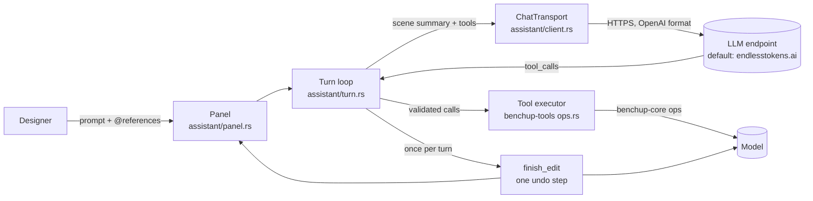

# Build with MIRA and MCP: contributor documentation

**Build with MIRA** is an optional AI design assistant for BenchUp. A designer describes a change in plain language and can refer to parts of the design ("make **@Left leg** 40 mm thicker"). An OpenAI-compatible language model proposes **tool calls**, and the editor applies them to the model. **Each assistant turn is one undo step.**

This folder is for people who want to understand, review or extend the assistant. If you only want to *use* it, read the user guide: [../assistant.md](../assistant.md).

The tools that MIRA calls live in a shared crate, `benchup-tools`, and are also served to external agents by the `benchup-mcp` server. MIRA and MCP are two add-ons on that crate. The MCP user guide is [../mcp.md](../mcp.md); how the two fit together is in [architecture.md](architecture.md#31-mira-and-mcp-as-two-add-ons-on-one-tool-layer).

> **Status:** proposed upstream in [BenchUp3D/editor#3](https://github.com/BenchUp3D/editor/pull/3) (draft), from the fork [aarvee11/editor](https://github.com/aarvee11/editor), branch `feature/build-with-mira`. The original proposal is [issue #1](https://github.com/BenchUp3D/editor/issues/1).

## Start here

| If you want to… | Read |
|---|---|
| Understand the overall design and how one turn flows end to end | [architecture.md](architecture.md) |
| Connect an external agent (Claude Code, Cursor, any MCP client) to BenchUp | [../mcp.md](../mcp.md) |
| See how MIRA and the MCP server share one tool layer | [architecture.md section 3.1](architecture.md#31-mira-and-mcp-as-two-add-ons-on-one-tool-layer) |
| Review the security of the agent bridge (token, Origin check, trust) | [persistence-and-security.md section 7.1](persistence-and-security.md#71-agent-bridge-threat-model) |
| Find a specific type, function or file, or see what changed outside the module | [module-reference.md](module-reference.md) |
| Look up or add a tool the model or an MCP agent can call | [tools.md](tools.md), [contributing.md](contributing.md#31-add-a-new-tool) |
| See exactly what is sent to and received from the LLM, including the system prompt and scene summary | [llm-protocol.md](llm-protocol.md) |
| Work on the panel, references, latch/unlatch window or busy gate | [ui-ux.md](ui-ux.md) |
| Know what is saved, where the API key lives, and the threat model | [persistence-and-security.md](persistence-and-security.md) |
| Run, write or debug tests, CI, or the web build check | [testing.md](testing.md) |
| Set up the fork and follow step-by-step recipes for common changes | [contributing.md](contributing.md) |
| See how and why the feature was built the way it was | [development-history.md](development-history.md) |
| Find known limitations, future work and good first issues | [roadmap.md](roadmap.md) |

## Design in one page



Principles behind the design:

1. **The model proposes, the editor decides.** Everything the LLM sends is treated as untrusted input. It is parsed into typed arguments, checked against limits, locks, visibility, edit scope and the shared-project lease, and run against a backup. A failure goes back to the model as a structured tool result so it can correct itself.
2. **One turn is one undo step.** The model is snapshotted lazily before the first change, and the turn commits exactly once through the editor's existing `finish_edit`. That function also handles shared-project permission, autosave and the GPU refresh.
3. **High-level woodworking tools, in millimetres.** Examples are `create_board`, `resize_board`, `add_joint` and `set_grain`; they don't work at the level of raw edges. Lengths are in millimetres at the boundary and in metres inside `benchup-core`.
4. **Provider-neutral code with a MIRA preset.** The module is called `assistant`. Any OpenAI-compatible Chat Completions server works. "Build with MIRA" and endlesstokens.ai are only the defaults.
5. **Off by default and private by default.** Nothing is sent until the user connects with their own key and sends a prompt. The key is stored per endpoint on the device, never in preferences or project files. The transcript is not persisted.
6. **Follows the repo conventions in [AGENTS.md](../../AGENTS.md).** That covers persisted UI state, the shared `Modal` with Cancel on the right, English `tr!` strings, appending the new inspector section, and keeping the viewport GPU-first (the busy banner is an egui overlay).

## What to look at where

| Area | Location |
|---|---|
| Assistant state, preferences and app glue (`assistant_send`, `poll_assistant`, `assistant_commit_turn`) | `crates/benchup-app/src/assistant/mod.rs` |
| HTTP transport (desktop ureq thread, web `fetch`), URL guard, error mapping, test fake | `crates/benchup-app/src/assistant/client.rs` |
| API key slot | `crates/benchup-app/src/assistant/credentials.rs` |
| Secrets on the device (API key, agent pairing token) | `crates/benchup-app/src/credentials.rs` |
| Scene summary and references sent to the model | `crates/benchup-tools/src/scene.rs` |
| Tool schemas, executor, limits, lease checks (shared by MIRA and MCP) | `crates/benchup-tools/src/ops.rs` |
| OpenAI adapter and text fallback parser | `crates/benchup-app/src/assistant/tools.rs` |
| `.bup` encode/decode and atomic save | `crates/benchup-tools/src/files.rs` |
| MCP server (stdio, file mode, live bridge) | `crates/benchup-mcp/src/` |
| Agent connection add-on (WebSocket client, pairing token, Settings section) | `crates/benchup-app/src/agent_link/` |
| Shared app-side host for agent calls (`tool_env`, `run_agent_call`) | `crates/benchup-app/src/agent_host.rs` |
| Agent loop (rounds, Stop, gate, commit result) | `crates/benchup-app/src/assistant/turn.rs` |
| Panel UI (connect modal, transcript, change cards, composer, `@` references) | `crates/benchup-app/src/assistant/panel.rs` |
| Latch/unlatch hosting (OS window or in-canvas window) | `crates/benchup-app/src/assistant/window.rs` |
| Tests | `crates/benchup-app/src/assistant/{tests,ui_tests}.rs`, `crates/benchup-tools/src/ops_tests.rs`, `crates/benchup-mcp/tests/mcp.rs`, `crates/benchup-app/src/agent_link/{tests,ui_tests}.rs` |
| Module registration, busy gate, keyboard shortcut, View menu | `crates/benchup-app/src/app.rs` |
| Inspector section and persisted preferences | `crates/benchup-app/src/sidebar.rs`, `inspector_docking.rs` |
| Shared-project lease, remote replacement handling | `crates/benchup-app/src/sharing.rs` |
| "Ask MIRA about this", Outliner drag source | `context_menu.rs`, `outliner.rs` |
| Shortcut setting | `settings.rs`, `shortcuts.rs` |
| Strings (`assistant.*`) | `assets/i18n/en.json` |
| CI for pull requests and branch pushes | `.github/workflows/ci.yml` |

`benchup-core` is **unchanged**: the assistant and the tool layer only call its existing public API.

## Five-minute tour for a new contributor

```sh
git clone https://github.com/aarvee11/editor.git benchup && cd benchup
git switch feature/build-with-mira
git remote add upstream https://github.com/BenchUp3D/editor.git
cargo test -p benchup-app assistant      # assistant tests, no network needed
cargo run -p benchup-app                 # desktop app
```

Then open **View → Build with MIRA** (Ctrl/Cmd+Shift+M), click **Connect**, paste a key from <https://portal.endlesstokens.ai/key> or point **Advanced → Base URL** at any OpenAI-compatible server, and try:

> Build a 600 × 400 × 750 mm side table with four 40 mm legs and 20 mm aprons, joined with mortise-and-tenon joints.

For anything beyond that, see [contributing.md](contributing.md).
