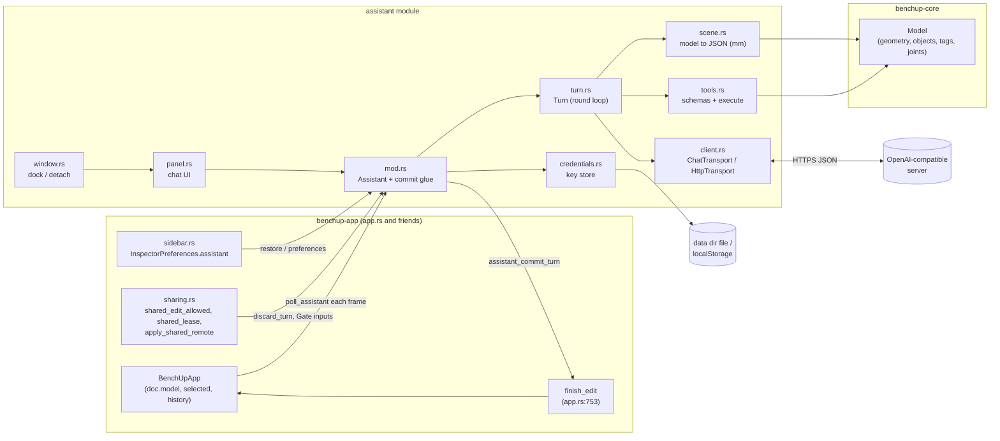
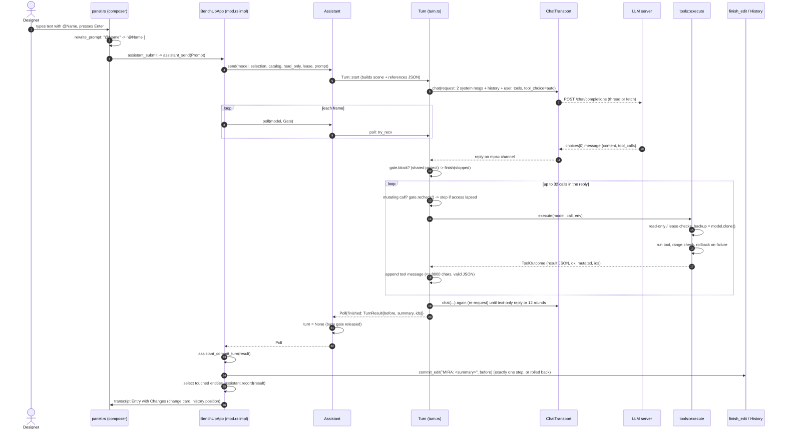
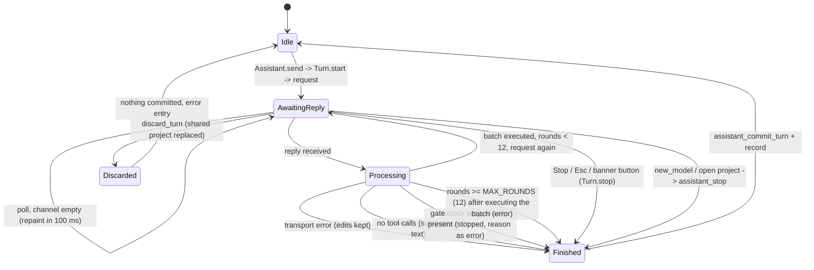
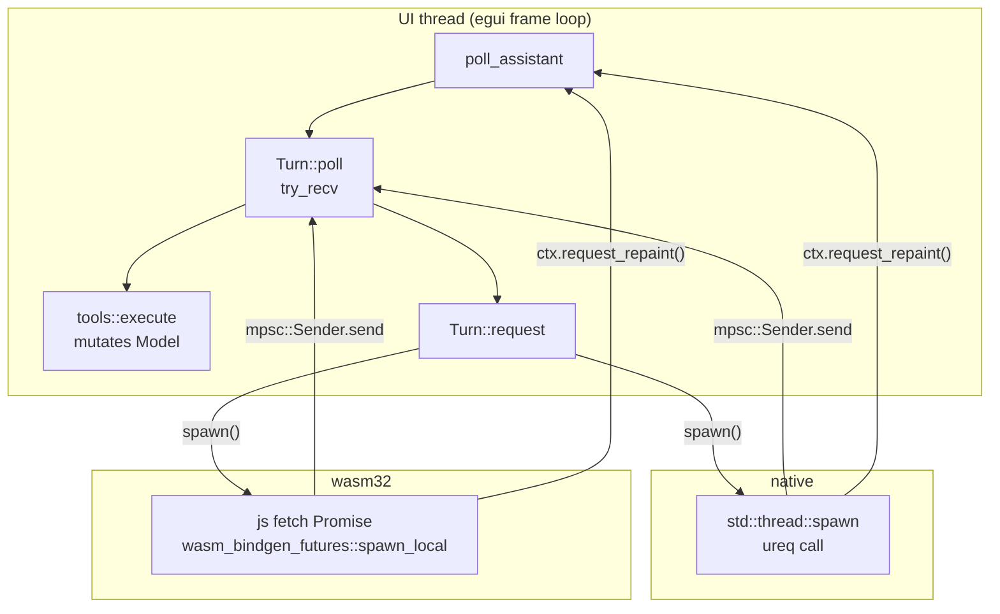
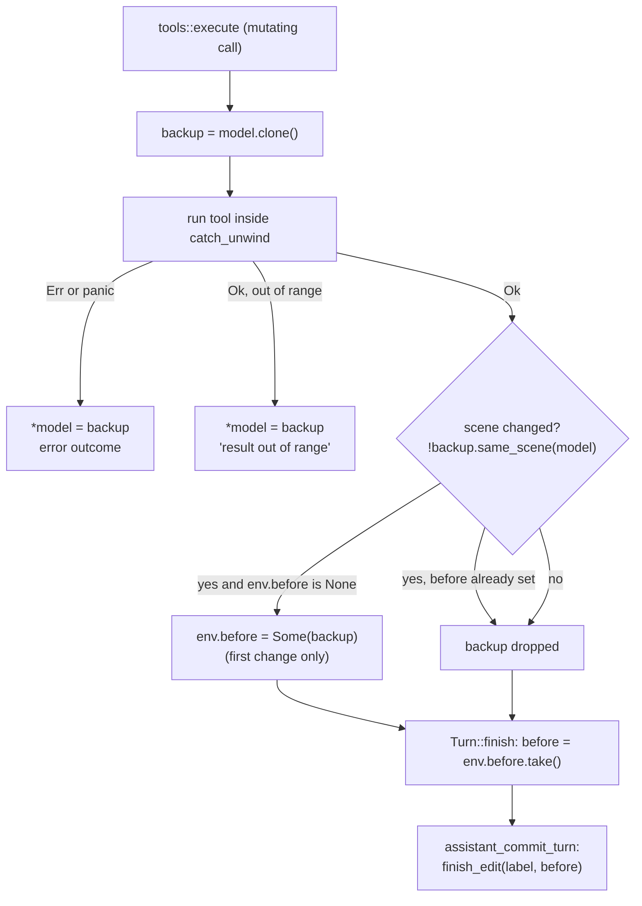

# Build with MIRA: architecture

[Docs index](../README.md) · [User guide](../assistant.md) · Architecture · [Module reference](module-reference.md) · [Tool catalog](tools.md) · [LLM protocol](llm-protocol.md) · [UI/UX](ui-ux.md) · [Persistence and security](persistence-and-security.md) · [Testing](testing.md) · [Contributing](contributing.md) · [Development history](development-history.md) · [Roadmap](roadmap.md)


**Citation convention.** Every `path:line` is relative to `crates/benchup-app/src/` unless it starts with `benchup-core/` (that is `crates/benchup-core/src/`). Line numbers are those of branch `feature/build-with-mira` after the commit "Fix issues found while documenting MIRA" (parent `44a7cc9`); they will drift as code changes, so search for the symbol name if a line is off.

The end-user view of the feature is in [../assistant.md](../assistant.md). This page is about how it is built.

## 1. Purpose, goals, non-goals

"Build with MIRA" lets a designer type a plain-language request. An LLM reached over an OpenAI-compatible Chat Completions API answers with *tool calls*; the editor executes those calls against the live `Model` and shows what changed (module doc, `assistant/mod.rs:-1`).

Goals (each one is visible in code):

| Goal | Where it shows |
|---|---|
| The LLM changes the model only through a fixed tool catalog, never by free-form output | `tools::definitions` `assistant/tools.rs:175`; `SYSTEM_PROMPT` `assistant/turn.rs:27` |
| One request equals exactly one undo step | `Assistant::poll`/`stop` return a `TurnResult`; `assistant_commit_turn` calls `commit_edit` (the logic of `finish_edit`) once (`assistant/mod.rs:488`, `app.rs:753`) |
| The UI thread never blocks | `ChatTransport` returns an `mpsc::Receiver` polled per frame (`assistant/client.rs:232`); `Turn::poll` uses `try_recv` (`assistant/turn.rs:203`) |
| Any OpenAI-compatible provider works; default preset is endlesstokens.ai | `DEFAULT_BASE_URL` `assistant/client.rs:9`, `valid_base_url` `assistant/client.rs:26` |
| A bad or hostile model reply cannot corrupt the model | per-call backup/rollback, argument validation, bounds, lease (`assistant/tools.rs:998`) |
| Works on desktop and in the browser (wasm32) | `cfg(target_arch)` split in `assistant/client.rs:285-357` and `assistant/credentials.rs:63-102` |
| The API key never lands in a project file or in preferences | `Preferences` has no key field (`assistant/mod.rs:49`); `assistant/credentials.rs:1` |
| Shared (collaborative) projects stay safe | `ToolEnv::read_only` / `lease` (`assistant/tools.rs:36,48`), `Gate` (`assistant/turn.rs:69`), `discard_turn` (`assistant/mod.rs:345`) |

Non-goals (things the code does *not* do; verified by absence):

* No streaming: `ChatRequest.stream` is always `false` (`assistant/turn.rs:194`).
* No retry or back-off: nothing in the module retries a failed request (grep for `retry`/`429` finds only a tool hint string, `assistant/tools.rs:452`).
* No cancellation of an in-flight HTTP request: `Stop` drops the receiver; the worker thread or fetch finishes on its own and its reply is discarded (`Turn::stop` `assistant/turn.rs:284`; the `let _ = sender.send(..)` at `assistant/client.rs:313,354`).
* No persistence of the transcript or of the model-facing history: both live in `Assistant` memory only (`assistant/mod.rs:128,133`).
* No tool-call memory across turns: `history` stores only user prompt text and the assistant's final summary, or a `(stopped)` / `(error: ...)` placeholder when there is none, so roles keep alternating (`Assistant::record` `assistant/mod.rs:413-428`).
* No image/vision input, no web access, no file access. The tools are listed in [tools.md](tools.md).
* No model-level (core) knowledge of the assistant: `benchup-core` has no assistant code and was not changed on this branch (`git diff 64b2a44..HEAD --stat` shows no `crates/benchup-core` files).

## 2. Where the code lives, and the layering

```
crates/
  benchup-core/            geometry + document model (no egui, no networking)
  benchup-app/src/
    app.rs                 BenchUpApp (the eframe::App), declares most modules via #[path]
    assistant/             <- this feature
      mod.rs               Assistant state machine + commit glue (impl BenchUpApp)
      client.rs            OpenAI-compatible HTTP client (+ test fake)
      credentials.rs       per-server API key storage
      scene.rs             model -> JSON for the LLM (mm)
      tools.rs             tool schemas + executor (JSON -> Model edits)
      turn.rs              one request: the round loop
      panel.rs             chat UI (impl BenchUpApp)
      window.rs            docked / detached hosting (impl BenchUpApp)
      tests.rs  tools_tests.rs  ui_tests.rs
```

Three layers:

| Layer | Crate / module | Knows about | Does not know about |
|---|---|---|---|
| Core | `benchup-core` | `Model`, entities, geometry, `JointSettings`, `tr!` | egui, HTTP, the assistant |
| App | `benchup-app` (`BenchUpApp`, `finish_edit`, history, sharing, sidebar) | core, egui, wgpu | LLM wire format |
| Assistant module | `benchup-app/src/assistant/` | core `Model` (read/write), a few `BenchUpApp` private fields, egui | rendering, geometry kernels |

Inside the module the dependency direction is: `panel`/`window` (UI) -> `mod.rs` (`Assistant`) -> `turn` -> `tools` + `scene` + `client`. `credentials` is used only by `mod.rs`. `tools` never touches `client` except for the `ToolCall` type (`assistant/tools.rs:6`).

### Why the module is declared from `app.rs` via `#[path]`

`app.rs` is the file that defines `BenchUpApp` (`app.rs:318`) and all its fields are private to the `app` module. Rust privacy lets a *descendant* module read private items of its ancestors. The assistant is therefore declared as a child of `app`:

```rust
// app.rs:88-89
#[path = "assistant/mod.rs"]
mod assistant;
```

`app.rs` declares its siblings the same way (flat `#[path = "fasteners.rs"] mod fasteners;` etc., for example `app.rs:90-91`), because the crate root `lib.rs:4` has plain `mod app;` and `app.rs` is not a `mod.rs` file. The `#[path]` is what lets the module live in a sub-directory while still being a child of `app`. The consequences, all used by the code:

* `assistant/mod.rs:6` does `use super::*;`, which brings every `app.rs` import and private item into scope (for example `Model`, `BTreeSet`, `egui`, `BenchUpApp`).
* The module can implement `impl BenchUpApp` blocks that touch private fields: `self.doc.model`, `self.selected`, `self.general_settings`, `self.assistant`, `self.history_preview` etc. (`assistant/mod.rs:438-527`, `assistant/panel.rs:152`, `assistant/window.rs:78`).
* Panel code reaches sibling app modules with `super::super::` (for example `super::super::sidebar`, `super::super::searchable_selector`, `assistant/panel.rs:4-8`): `panel` -> `assistant` -> `app`.
* Submodules inside `assistant/` use `#[path = "client.rs"]` again (`assistant/mod.rs:11-27`) so each file keeps its flat name next to `mod.rs`.

The cost: the assistant is tightly coupled to `BenchUpApp` internals. The pure parts (`client`, `scene`, `tools`, `turn`, `credentials`) deliberately avoid that coupling and take explicit arguments (`&mut Model`, `Gate`, `TurnSetup`), which is what makes them unit-testable without an app.

## 3. Component diagram



## 4. One turn, end to end



Step-by-step with citations:

1. **Prompt and references.** `assistant_submit` (`assistant/panel.rs:189`) calls `assistant_compose` (`:178`) -> `rewrite_prompt` (`:105`). Typed `@Name` that matches a chip becomes `@Name [#id]`; chips never typed into the text are appended as `Also referenced: ...` (`:136-143`). The id set (every chip, `:142`) becomes `Prompt.references` (`assistant/mod.rs:121`).
2. **Pre-flight.** `Assistant::send` (`assistant/mod.rs:298`) fails fast with a user-facing string if busy, prompt empty, URL invalid, no key, or no model (`:309-321`). Failures are shown as `ui.notice` (`assistant/panel.rs:205`) and **do not** create a transcript entry.
3. **Setup.** `BenchUpApp::assistant_send` (`assistant/mod.rs:468`) snapshots the stock catalog from `general_settings.stock.wood`, `read_only = !shared_edit_allowed(ctx)` and `lease = shared_lease()` (`sharing.rs:738,752`). `Turn::start` (`assistant/turn.rs:129`) merges selection into references when `include_selection`; when it is off the selection is left out of the scene summary too and `ToolEnv.hide_selection` makes `get_selection` answer with a note (`:138-141`). It renders `references` within `REFERENCE_BUDGET` (`:25`) and `scene::summary` within the remainder, and builds the first request. Details: [llm-protocol.md](llm-protocol.md).
4. **Request.** `Turn::request` (`assistant/turn.rs:188`) clones `messages` + `tools` into a `ChatRequest` and calls `transport.chat`, which returns a `Receiver` at once.
5. **Poll.** Every frame `poll_assistant` (`assistant/mod.rs:440`, called from `app.rs:6433`) builds a `Gate`, calls `Assistant::poll` -> `Turn::poll`. If the reply is not ready it returns idle and `Assistant::poll` schedules `request_repaint_after(100 ms)` (`assistant/mod.rs:351-353`).
6. **Execute.** For each call (max 32 per reply, `MAX_CALLS_PER_REPLY` `assistant/turn.rs:23`) `tools::execute` (`assistant/tools.rs:998`) applies it; the JSON result goes back as a `tool` message; one longer than `MAX_TOOL_RESULT_CHARS` is replaced by `{"ok":..,"truncated":true,"preview":"..."}`, which is still valid JSON (`truncated_result`, `assistant/turn.rs:20,115`). Before each mutating call the turn asks `Gate.recheck` whether editing is still allowed (`:252-256`). `mutated` makes `poll_assistant` call `self.changed(ctx)` so the viewport refreshes (`assistant/mod.rs:461`).
7. **Re-request.** After the batch, `rounds += 1` and either the round cap ends the turn or `request` is called again with the grown message list (`assistant/turn.rs:274-280`). The *scene JSON in the second system message is not refreshed*; the model learns about changes from tool results or by calling `get_scene`.
8. **Finish.** A reply with no tool calls ends the turn with that text as the summary (`:242-244`). `Turn::finish` (`:289`) builds the `TurnResult`: ids filtered to what still exists, ids created-then-erased dropped, default summary "Done." when the text is empty, and `before` taken from `ToolEnv`.
9. **Commit.** `assistant_commit_turn` (`assistant/mod.rs:488`) puts the user back in the edit scope they had when the turn began (`restore_scope`, `:434`), calls `commit_edit(label, before)` once (a wrapper of `finish_edit` that reports whether the step was recorded), selects touched top-level entities, records the transcript and history, and stores the history position on the card, only when this turn produced a card (`:538-551`). If the edit was refused and rolled back, the card is dropped and an error entry says so.
10. **Change card.** `change_card` (`assistant/panel.rs:892`) lists created/modified/joints and erased names (max 12 rows in total, `CARD_ROWS` `:64`; a final "+N more" counts every category not shown) and enables "Undo turn" only if `turn_undoable` (`:986`).

## 5. Turn state machine

`Turn` has no state enum. The states are implied by two facts: whether `Assistant.turn` is `Some` (`assistant/mod.rs:134`), and whether `Turn.pending` is `Some` (`assistant/turn.rs:95`). Everything between "reply arrived" and "next request sent / turn finished" happens inside a single call to `Turn::poll`, so it is atomic from the UI's point of view.



| Transition | Code | Notes |
|---|---|---|
| Start | `Turn::start` `assistant/turn.rs:129`, `Assistant::send` `assistant/mod.rs:298` | `started_at` is `ctx.input(\|i\| i.time)` (`:182`) |
| Poll, no reply | `TryRecvError::Empty` -> idle `assistant/turn.rs:205` | |
| Channel dropped | `TryRecvError::Disconnected` -> `ChatError::Network("The request was interrupted")` `:206-208` | e.g. worker thread panicked |
| Transport/parse error | `finish(.., Some(error.user_message()), false)` `:214` | Tool edits already applied are **kept** and still committed |
| Text-only reply | `finish(model, content, None, false)` `:243` | Empty text becomes "Done." (`:303-305`) |
| Gate blocked | `:229-234` | Returns `stopped = true` with the block reason as the error. Evaluated when the reply has tool calls |
| Gate re-check | `:252-256` | Before each mutating call of a reply, `gate.recheck` is asked again; a reason ends the turn as stopped before that call runs |
| Round limit | `MAX_ROUNDS = 12` (`:17`); check at `:275-278` | The 12th batch **is executed** before stopping. Error text from `assistant.error.round_limit` |
| Stop | `Assistant::stop` `assistant/mod.rs:359` -> `Turn::stop` `assistant/turn.rs:284` | `pending = None`; result carries `stopped = true`; edits kept |
| `discard_turn` | `assistant/mod.rs:366` | Calls `turn.stop`, puts the live model back in its starting scope, clears `before`, `selection` and all id lists, sets the error, records. Nothing reaches `finish_edit` |

Where Stop comes from: the composer Stop button (`assistant/panel.rs:767`), the busy banner button (`:1019`), Esc while busy (`app.rs:2160-2163`), `new_model` (`app.rs:995`) and `open_project`-style loading (`projects.rs:166`).

**Gate re-check.** While busy, `poll_assistant` computes a `Gate` *every frame* (`assistant/mod.rs:440-459`): `block` is `Some(shared_edit_block_reason)` when `shared_edit_allowed` is false, `lease` is the current `shared_lease()`, and `recheck` is a closure that asks the same question again. Because the closure needs `&self` while the assistant and the model are borrowed mutably, `poll_assistant` temporarily moves both out of `self` (`std::mem::take`) for the duration of `Assistant::poll`; the check reads only sharing state, never the assistant or the model. `Turn::poll` applies the gate in three places: when a reply with tool calls arrives and `gate.block` is set, the turn ends instead of executing; otherwise `env.lease` is overwritten with the fresh lease so a lease that changed between rounds is enforced; and before *each mutating call* in the batch `recheck` is asked again, so access that lapses inside a 32-call batch stops the turn before the next edit. Remaining limitation: the lease itself is refreshed once per reply (see [section 12](#12-gaps--unclear)).

## 6. Threading model

Everything that reads or writes the `Model` runs on the UI thread, inside `Turn::poll` and `tools::execute`. Only the network I/O is off-thread.



| | Native | Web (wasm32) |
|---|---|---|
| Worker | `std::thread::spawn` per request (`assistant/client.rs:286`) | JS `fetch` wrapped by `js_sys::Function`, awaited in `wasm_bindgen_futures::spawn_local` (`:321-356`) |
| Result delivery | `sender.send(result)` then `ctx.request_repaint()` (`:313-314`) | same, from the async block (`:354-355`) |
| Timeout | `ureq` `timeout_global` 120 s (`:289`) | `AbortSignal.timeout(120000)` (`:329`) |
| Redirects | `max_redirects(0)` (`:290`) | `redirect: 'error'` (`:329`) |
| Size cap | `.limit(RESPONSE_LIMIT)` 4 MiB (`:308`) | `Content-Length` check + body length check at 4194304 (`:327-330`) |
| Panic in a tool | `catch_unwind` -> rollback (`assistant/tools.rs:1021`) | A panic aborts; **no recovery** (comment `assistant/tools.rs:1018-1020`) |

The receiver is the only synchronisation primitive. Because the poll loop is `try_recv`, there is no lock, no `Arc<Mutex<Model>>`, and no way for a worker thread to see the model. `Model` is also never sent to a worker: `Turn` holds `messages: Vec<Message>` (JSON-ish data) and a cloned `ChatRequest` crosses the thread boundary.

`Assistant` is also polled for the model-list request (`poll_models`, `assistant/mod.rs:234`), through the same channel pattern (`models_receiver`, `:136`).

The detached window on desktop is an *immediate viewport* (`ctx.show_viewport_immediate`, `assistant/window.rs:251`) so the closure can borrow `&mut self`; everything still runs on the UI thread.

## 7. Undo and commit semantics

**Exactly one `finish_edit` per turn**, and none when the turn changed nothing.



* **Lazy `before` snapshot.** `ToolEnv.before` (`assistant/tools.rs:45`) is `None` until the first call that actually changes the scene: `mutated = !backup.same_scene(model)` and `if mutated && env.before.is_none() { env.before = Some(backup) }` (`assistant/tools.rs:1047-1051`). Read tools, failed calls and no-op calls never set it. `Model::same_scene` (`benchup-core/src/document.rs:113`) deliberately ignores the editing scope (`edit_context`).
* **Per-tool rollback.** Mutating tools take `model.clone()` before running (`assistant/tools.rs:1017`). On `Err`, panic (native only), or out-of-range result, `*model = backup` restores it exactly (`:1028-1039`). `tools_tests.rs::err` asserts the model is unchanged on every error.
* **Commit.** `assistant_commit_turn` (`assistant/mod.rs:488`):
  1. `erased_names` are read from `before` (the entities are gone from the live model) (`:490-494`).
  2. `restore_scope(&mut self.doc.model, result.scope)` (`:497`) puts the designer back in the scope they had at turn start; the snapshot `before` already carries that scope (`Turn::finish`, `assistant/turn.rs:300`), so the recorded step has no scope change and undoing it leaves the designer where they were.
  3. Label: `assistant.history_stopped` ("MIRA (stopped)") if `result.stopped`, else `assistant.history_label` = "MIRA: {summary}" with the summary cut to 60 chars and trimmed (`:500-505`).
  4. `commit_edit(&label, before, ctx)` (`:506`, definition `app.rs:758`; `finish_edit` is its `()`-returning wrapper) records a single `history.record_applied_attributed` and returns `true`. It refuses and reverts (returning `false`) when `assistant.busy()` - safe here because the turn was already removed (`self.turn = None` in `poll`/`stop`) - and when `!shared_edit_allowed`. If the edit was real (`before != model`) but not recorded, the turn's id lists and selection are cleared and an error entry (`assistant.error.rolled_back`) is appended, so no change card claims the rolled-back edits (`:507-516`).
  5. Touched top-level, visible entities become the selection (`:518-526`); a `select` tool call (`TurnResult.selection`) then overrides it, filtered to existing, visible ids (`:528-532`).
  6. `assistant.record` appends transcript + history and returns whether it added a change card; only then does the newest card get `position = history.position()` (if `recorded`), so a later turn with no changes leaves earlier cards, and their Undo turn, intact (`:538-551`).
* **Stop** (button, banner, Esc): `Turn::stop` -> `finish(.., stopped = true)`. Edits already applied are committed as one step labelled "MIRA (stopped)". If nothing changed, `before` is `None`, nothing is recorded in history, and the transcript only gets an entry if there is a summary, changes or error (`Assistant::record` `assistant/mod.rs:380-428`).
* **Errors mid-turn** (network failure, round limit) also keep the partial work as one step with the normal "MIRA: ..." label (summary may be empty -> label "MIRA:").
* **Discard** (remote replacement): no commit at all (section 9).
* **Undo turn** in the card calls the normal `undo` (`assistant/panel.rs:550`), which goes through `navigate_history`. It is offered only while `changes.position == history.position() == latest` (`turn_undoable` `:986`). `navigate_history` itself refuses while busy (`app.rs:814`).
* **`catch_unwind` and wasm.** `std::panic::catch_unwind(AssertUnwindSafe(..))` wraps `run` (`assistant/tools.rs:1021`). The code comment states that `catch_unwind` cannot help on wasm32, where a panic aborts (`assistant/tools.rs:1018`), so every tool validates counts, ranges and lengths *before* touching the model, and results are range-checked afterwards (`MAX_RESULT_M`). The user guide says the page must be reloaded after such a crash ([../assistant.md](../assistant.md)). On native a caught panic returns the error "internal error while applying the tool" (`:1021`) after restoring the backup, but the default panic hook may still print to stderr.
* **Edit scope is restored.** `enter_object` / `exit_to_root` write `model.edit_context` directly and are classified non-mutating (`assistant/tools.rs:125-126`), so they take no snapshot. `Turn` records the scope at start (`Turn.scope`, `assistant/turn.rs:174`); when the turn ends, is stopped or is discarded the app puts the user back in it (`restore_scope`, called from `assistant_commit_turn` and `discard_turn`), and `before.edit_context` is set to it, so undoing a MIRA turn leaves the user in the scope they were in. If that object no longer exists the user lands at the top level. Tests: `a_turn_puts_the_designer_back_in_their_edit_scope_and_undo_keeps_it`.

## 8. The busy gate

"Busy" is simply `Assistant::busy() = turn.is_some()` (`assistant/mod.rs:177`). While busy:

| What | Where |
|---|---|
| Editor-driven model changes are reverted with a message `assistant.busy_blocked` | `finish_edit` `app.rs:762-766` |
| Undo/redo/history navigation refused | `navigate_history` `app.rs:814` |
| Keyboard: only Esc (stops the turn) is processed; the toggle shortcut is handled before | `app.rs:2156-2164` |
| Pointer: primary-button gestures are ignored unless the tool is Select or Orbit (camera, middle button and selecting remain) | `app.rs:4509-4515` |
| Composer Enter does not submit; `send` returns "still working" | `assistant/panel.rs:654`, `assistant/mod.rs:309` |
| Model picker cannot change the model; "New chat" is disabled | `assistant/panel.rs:370`, `:296`; `Assistant::new_chat` `assistant/mod.rs:227` |
| A banner with a spinner and Stop is drawn | `assistant_busy_banner` `assistant/panel.rs:1000` |
| Starting a turn cancels in-progress tool gestures so they cannot collide | `assistant_cancel_interactions` `assistant/panel.rs:209` (called from `assistant_submit` `:195`) |

The gate is implemented at the *app entry points* listed above, not inside `Model`. I did not audit every code path that can mutate `doc.model` (for example sidebar edits that bypass `finish_edit`); see [Gaps](#12-gaps--unclear).

## 9. Shared-project behaviour

Three independent mechanisms, all on the UI thread:

1. **Read-only.** `assistant_send` sets `read_only = !shared_edit_allowed(ctx)` (`assistant/mod.rs:476`). `shared_edit_allowed` (`sharing.rs:738`) is true for non-shared projects, otherwise requires role owner/edit, no conflict, a baseline, a server acknowledgement in the last 10 s, and the selection to equal the confirmed lease selection. When `read_only`, every mutating tool returns `{"ok":false,"error":"read-only","hint":...}` before anything else (`assistant/tools.rs:1005-1010`). Read tools still work.
2. **Lease.** `shared_lease()` (`sharing.rs:752`) is `Some(sharing.confirmed.clone())` for shared projects, `None` otherwise. `execute` rejects a mutating call whose *existing* target ids (`ids`, `id`, `face_id`, `a`, `b`) are outside the lease, with `"not-leased"` and the hint "select it first so you hold the edit lease" (`assistant/tools.rs:1012-1016`). An id is leased if it or any ancestor is in the lease, or was created (or released by `ungroup`) by this turn (`leased` `:976`, `env.created` `:1041`). Pure creators (`CREATING`, `:961`) are exempt. The non-mutating `select` tool is held to the same rule: with a lease, it refuses ids that are neither leased nor created this turn (`:914`); `create_copy` can still *read* an unleased source, and the copy is new.
3. **Remote replacement.** `apply_shared_remote` calls `assistant.discard_turn(...)` *before* replacing `doc.model` (`sharing.rs:376`). The turn is stopped, its snapshot, selection and id lists are cleared, the error "The shared project changed; MIRA stopped" is recorded, and nothing is committed (`assistant/mod.rs:342-351`), so a stale `before` can never land in the remote history; the live model's edit scope is restored first so the scope the turn opened is not carried into the replaced project. Test: `sharing.rs:1201-1229` (`a_remote_replacement_discards_the_running_mira_turn`).

In addition the per-frame `Gate` (section 5) stops a running turn when edit access lapses, and it is re-checked before each mutating call. If access lapses between the last edit and the commit, `commit_edit` reverts the model, the change card is not shown, and the transcript gets the error `assistant.error.rolled_back` (test `a_rolled_back_turn_does_not_claim_its_edits_on_the_change_card`).

## 10. Error-handling philosophy

* **Tool failures are data for the model, not exceptions.** Every failure becomes `{"ok":false,"error":..,"hint":..}` and goes back as the tool message so the model can self-correct in the same turn (`error_outcome` `assistant/tools.rs:943`; module doc `:1-4`). Hints name the next tool to call.
* **Fail closed, restore exactly.** A failed or out-of-range mutating call restores a full model clone. The cost is one `Model::clone` per mutating call; this is a deliberate trade for correctness (unmeasured here).
* **Validate before touching the model.** Counts, lengths, finite numbers and coordinate bounds are checked up front (`MAX_IDS`, `MAX_POINTS`, `MAX_TEXT_CHARS`, `MAX_COORDINATE_MM`, scale bounds; `assistant/tools.rs:20-30`), because on wasm there is no panic recovery.
* **Transport errors are typed** (`ChatError`, `assistant/client.rs:42`) and mapped to user-facing English strings via `tr!` (`user_message` `:53`). They end the turn but keep partial work.
* **Server error text is untrusted:** cut to 300 chars (`MAX_ERROR_CHARS` `assistant/client.rs:17`).
* **User-input problems never start a turn:** `send` returns `Err(String)` shown as a notice (`assistant/mod.rs:298-321`).
* **Credentials errors are non-fatal:** if saving the validated key fails the user is still connected for the session and gets an error entry (`assistant/mod.rs:265-272`).
* **Untrusted shape:** unknown tool names, extra argument fields (`deny_unknown_fields`), string-or-object `arguments`, missing tool-call ids, and fenced-JSON tool calls are all tolerated or refused explicitly (`assistant/client.rs:76-83`, `assistant/turn.rs:224-228`, `assistant/tools.rs:1088`).
* All user-facing text goes through `tr!` and lives in `assets/i18n/en.json` (86 `assistant.*` keys at this commit). Tool `error`/`hint` strings sent to the model are *not* translated (they are plain Rust strings).

## 11. Extension points

| You want to... | Touch | Notes |
|---|---|---|
| Add a tool | `TOOLS` (`assistant/tools.rs:99`), `definitions()` (`:175`), an `*Args` struct (`:279-423`), the tool fn, the `run` match (`:865`) | `tool_definitions_are_strict_and_match_the_executor` (`tools_tests.rs:305`) fails if schema and executor disagree. Read the lease rule: if the tool only creates, add to `CREATING` (`tools.rs:961`); if it takes ids under new key names, extend `target_ids` (`tools.rs:964`). Full procedure in [contributing.md](contributing.md) and [tools.md](tools.md) |
| Change the prompt | `SYSTEM_PROMPT` (`assistant/turn.rs:27`) | quoted in [llm-protocol.md](llm-protocol.md) |
| Change what the model sees of the scene | `scene::summary`, `object_entry`, `describe` (`assistant/scene.rs:129,71,217`) and the budgets (`:9-12`) | budgets are characters, not tokens |
| Support a provider quirk | `client.rs`: `ResponseMessage`/`ToolCall` serde (`:161,95`), `check_status` (`:194`), `says_tools_unsupported` (`:182`), `fallback_tool_call` (`tools.rs:1088`) | keep the `ChatTransport` trait stable for tests |
| Replace the transport (for tests, proxies, streaming) | implement `ChatTransport` (`assistant/client.rs:232`) and pass to `Assistant::with_transport` (`assistant/mod.rs:153`) | the test `FakeTransport` is at `assistant/client.rs:371` |
| Change limits | `MAX_ROUNDS`, `MAX_CALLS_PER_REPLY`, `MAX_TOOL_RESULT_CHARS` (`assistant/turn.rs:17-23`); `HISTORY_*` (`assistant/mod.rs:32-33`) | update the user guide troubleshooting numbers |
| Add a persisted option | `Preferences` (`assistant/mod.rs:49`) with `#[serde(default)]`; sanitise in `sanitized` (`:69`) | the repo rule is to persist every option via `InspectorPreferences` and save through `persist_inspector_changes` (see `AGENTS.md`) |
| Add a panel control | `panel.rs`; session-only state goes in `UiState` (`assistant/panel.rs:46`) | modal footers declare least-impactful first (repo rule; see the Connect dialog `:476-481`) |
| Change docking or window behaviour | `window.rs` | |
| New strings | `assets/i18n/en.json` with `assistant.` prefix, use `tr!` | English only (repo rule) |
| Change history/undo behaviour | `assistant_commit_turn` (`assistant/mod.rs:488`) | keep the single-`finish_edit` invariant |

## 12. Gaps / unclear

Items 1-3, 6 and 7 of the earlier list and the per-call part of item 4 were fixed in the commit "Fix issues found while documenting MIRA" (see [roadmap.md](roadmap.md#23-fixed-in-fix-issues-found-while-documenting-mira)). What remains:

1. **The edit lease is refreshed once per reply** (`assistant/turn.rs:235`), not per call; edit *access* is re-checked before every mutating call. A lease change within a 32-call batch is not seen until the next reply.
2. **Stale scene (documented design choice).** The scene system message is built once per turn (`assistant/turn.rs:147-150`) and never refreshed; a multi-round turn relies on tool results, and the model can call `get_scene`. The fixed part of the scene (selection, tags, stock catalog, joints: at most 200, 100, 40 and 100 entries) is count-capped rather than budgeted; only the object list is filled up to the character budget.
3. **The history keeps the *rewritten* prompt** with `[#id]` markers, clipped to 2000 characters, and no tool calls (by design).
4. **Busy gate coverage not audited (documented design choice).** I only verified the entry points listed in section 8, not every direct mutation of `doc.model`.
5. **Provider facts are maintainer-supplied.** The endlesstokens.ai CORS preflight date (the preflight `Date` header was Mon, 09 Nov 2026 04:15:31 GMT, which is the evening of 2026-11-08 in US Pacific time), 2 parallel sessions per key, model names and `et:auto` tool support cannot be verified from the code; see [llm-protocol.md](llm-protocol.md).
6. **Credential file permissions are only tightened on unix** (`assistant/credentials.rs:33-45`); behaviour on Windows is whatever the OS default is.
