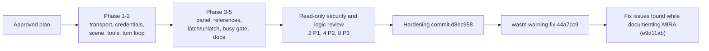

# Build with MIRA: development history

[Contributor docs](README.md) · [Architecture](architecture.md) · [Testing](testing.md) · [Contributing](contributing.md) · [Roadmap](roadmap.md)

How the feature was built, and why it looks the way it does. Facts about the original request, the research and the decisions were supplied by the project owner (GitHub `aarvee11`, MIRA Stack Labs); I could not verify them from the repository. Commit facts were checked with `git log` and `git show`.

## 1. Origin

On **2026-11-08** the project owner opened `BenchUp3D/editor` issue **#1**, titled "Excellent Initiative - I would like to add the AI plugin from MIRASTACKLABS" (<https://github.com/BenchUp3D/editor/issues/1>). The issue had only a title and no maintainer reply at the time of writing.

The ask, in the owner's words, was a feature called **"Build with MIRA"**: connect the editor to **endlesstokens.ai** with an API key and use large language models to build and edit in the app. The intended flow is designer-first: the designer quotes a part of the design in a prompt, the model suggests edits, and the editor applies them.

## 2. Research

* endlesstokens.ai offers an **OpenAI- and Anthropic-compatible API** at `https://api.endlesstokens.ai/v1`.
* A CORS preflight against it returned `Access-Control-Allow-Origin: *` (checked as supplied; the preflight response's `Date` header was Mon, 09 Nov 2026 04:15:31 GMT, which is the evening of 2026-11-08 in US Pacific time, the time zone of the commit log). That is what lets the browser build call the API with `fetch` and no backend, and it is why the web path sends `credentials: 'omit'` (a wildcard origin is only accepted for requests without ambient credentials; comment at `crates/benchup-app/src/assistant/client.rs:319-320`).
* The default model is **Qwen3.8-27B**, with **2 parallel sessions per key**. (In the code the default is a hint: the first listed model containing `qwen`, `assistant/mod.rs:34,276-283`; the user guide tells users about the two-session limit.) These provider facts cannot be checked from the code.

## 3. Decisions taken with the owner

| Decision | Alternative that was not chosen | Where it shows up |
|---|---|---|
| Apply edits **immediately**, with **one undo step per turn** | Preview each change and ask the user to approve it | `assistant_commit_turn` commits once via `finish_edit` (`assistant/mod.rs:488-552`); "Undo turn" on the change card (`assistant/panel.rs:892`). Preview/approve is future work ([roadmap.md](roadmap.md)). |
| A **flexible panel** that can latch to the sidebar and unlatch into its own window | A fixed sidebar section only | `assistant/window.rs`: native OS window or in-canvas window, for CAD/CAM and architect multi-monitor workflows ([ui-ux.md](ui-ux.md#8-latch-and-unlatch)) |
| **Remember the API key on the device** | Ask for the key every session | `assistant/credentials.rs` (private file natively, `localStorage` on web), never in preferences or projects ([persistence-and-security.md](persistence-and-security.md#5-api-key-storage)) |
| **endlesstokens as the default**, with **flexible model choice** and a configurable OpenAI-compatible base URL | Hard-wired to one provider and model | `DEFAULT_BASE_URL`, model picker and "Change endpoint…" ([contributing.md](contributing.md#32-add-a-provider-preset-or-a-default-model)) |
| **Deliver as a pull request from the fork** | Push to upstream | The owner has read-only access to `BenchUp3D/editor`. Work lives on `aarvee11/editor`, branch `feature/build-with-mira`, and the draft PR is <https://github.com/BenchUp3D/editor/pull/3>. |
| Keep the code **provider-neutral**: a module called `assistant`, with MIRA only as the default preset | A module named after one vendor | `crates/benchup-app/src/assistant/`; user-visible name "Build with MIRA" comes from `assistant.name` in `assets/i18n/en.json` |

The original design proposal (the text intended for the issue thread) also described `@` references to tags and joints and "each assistant turn is one undo step". Tags and joints are not offered by the current `@` popup (`assistant/panel.rs:556-576` lists only groups and components); see [roadmap.md](roadmap.md).

## 4. Process

1. **Plan.** A plan was written and approved before code (the work followed the planner/implementer/reviewer split described in the owner's global instructions: plan with a strong model, implement with a cheaper one, then review read-only).
2. **Phases 1-2.** HTTP transport (`client.rs`), per-endpoint key storage (`credentials.rs`), the scene summary (`scene.rs`), the validated tool set (`tools.rs`) and the non-blocking turn loop (`turn.rs`), tested with a scripted `FakeTransport`.
3. **Phases 3-5.** The chat panel and change cards, `@`/drag/context-menu references, latch/unlatch with persisted placement, the busy gate that protects the model while a turn runs, and the user guide `docs/assistant.md`.
4. **Review.** A read-only security and logic review of the result produced **2 P1, 4 P2 and 8 P3 findings** (14 in total). All fourteen are tracked in this documentation as Q01-Q14 ([persistence-and-security.md](persistence-and-security.md#8-hardening-log-review-findings-q01-q14-commit-d8ec958)). Q14 (CI: third-party actions pinned by tag, and duplicate push and pull request runs) was intentionally not changed: third-party actions use tags, consistent with the existing `build.yml`, and a pull request from a fork runs in the upstream repository while a fork push runs in the fork, so they do not duplicate.
5. **Hardening.** Commit `d8ec958` addressed the findings: edit-lease enforcement, shared-project races, bounded model-driven work, push_pull scope checks, a stricter text-tool-call fallback, key-file permissions, key/URL binding, error truncation, tools-unsupported detection, a web `Content-Length` check, a shared request budget, and reserved shortcut keys.
6. **Verification at each phase.** After every phase the tests were run and the **set of failing tests was diffed against a clean `main` worktree**. The result was identical each time: the same **31 pre-existing failures** ([testing.md](testing.md#2-the-31-pre-existing-failures-on-main)). The comparison is by test name, not by count.

## 5. CI

The repository had no workflow that runs on pull requests (`build.yml` runs on version tags and `pages.yml` on the result of that build), so `.github/workflows/ci.yml` was added: a Linux job (`cargo check --workspace --all-targets`, core tests, assistant tests, release-critical modules) and a wasm32 browser check.

* The **first run failed on a YAML error**: the step `cargo test ... assistant::` was unquoted and `::` broke the parse. Fixed in `87c1be8` by quoting `'assistant::'`.
* **Later runs on the fork were blocked by a GitHub account billing lock**, not by code; jobs did not start.
* The run for the **upstream draft PR** (<https://github.com/BenchUp3D/editor/pull/3>) was waiting for a maintainer to approve it (`action_required`), which GitHub requires for first-time contributors.
* While CI was blocked, the browser build was checked locally with a rustup toolchain installed with `--no-modify-path`. That check initially reported one warning (an import used only by the native window). Commit `44a7cc9` fixed it, and the local check `CARGO_TARGET_DIR=target/rustup-wasm ~/.cargo/bin/cargo check -p benchup-app --locked --target wasm32-unknown-unknown` now **passes with 0 warnings** (reported 2026-11-09; see [testing.md](testing.md#9-local-wasm32-check)).
* One gap found afterwards: the CI test filter `assistant::` did not match the `assistant_ui` tests, the docking test or the `sharing.rs` test ([testing.md](testing.md#47-ci-coverage)). It was fixed in the documentation commit below: CI now runs the substring filters `'assistant'` and `'mira'`.

## 6. Commits

All on branch `feature/build-with-mira`, author `aarvee11`, 2026-11-08 (`git log --format='%h %ad %s' 64b2a44..HEAD`). Each message ends with a `Co-Authored-By` line naming the model that helped. The branch point is upstream `main` at `64b2a44` ("Correct remapped entity IDs and joinery regression fixtures", Danny Coulombe).

| Hash | Title | What it contains |
|---|---|---|
| `2cad323` | Add Build with MIRA, an optional LLM design assistant | The whole feature (26 files, +5 460 lines): `assistant/` module (`mod`, `client`, `credentials`, `scene`, `tools`, `turn`, `panel`, `window` and three test files); wiring in `app.rs`, `sidebar.rs`, `inspector_docking.rs`, `context_menu.rs`, `outliner.rs`, `settings.rs`, `shortcuts.rs`, `projects.rs`, `icons.rs`; i18n keys; 27 tools; busy gate; README section; `docs/assistant.md`, `docs/README.md`, `docs/sidebar.md`. Message ends "Relates to #1". |
| `746d844` | Add CI workflow for pull requests and branch pushes | `.github/workflows/ci.yml` with the native job and the wasm32 check; no other files. |
| `87c1be8` | Quote CI test filter so the workflow parses | One-line fix: `assistant::` becomes `'assistant::'`. |
| `d8ec958` | Harden MIRA against shared-project races and untrusted tool input | The review fixes (13 files, +669/-60): lease enforcement and `discard_turn`, call/round/size bounds, `push_pull` owner-chain checks, fallback parser tightening, `0600` re-applied on save, key bound to the validated server, error and result truncation, shared scene budget, stricter tools-unsupported detection, web `Content-Length` check, reserved shortcut keys, `shared_lease()` and test hooks in `sharing.rs`, new tests. |
| `44a7cc9` | Gate desktop-only Palette import in the assistant window | Gates `use crate::theme::Palette` with `cfg(not(target_arch = "wasm32"))` in `assistant/window.rs`; removes the only warning of the wasm32 build. |
| `e9d11ab` | Fix issues found while documenting MIRA | The 17 findings from writing these documents: `Include selection` off now hides the selection from the scene and `get_selection`; a rolled-back turn no longer shows a change card; the edit scope is restored after a turn and by undo; edit access is re-checked before every mutating call; oversized tool results are valid JSON; history roles alternate; tag-name and `scale` schemas match their executors; Shift+Enter inserts a newline; a no-change turn keeps earlier Undo turn cards; a typed model survives a model list that omits it; the base URL is saved only after a successful connect; "Bring to front" works on the web; the change card counts erased rows in "+N more"; `select` is limited to the lease; CI runs `'assistant'` and `'mira'`; `.env.local` is ignored. Regression tests for each, and these documents. |

In total the branch changes 28 files (+6 146 / -15 lines up to `d8ec958`, `git diff --stat 64b2a44..d8ec958`).

## Gaps / unclear

* The review report itself, the approved plan and the per-finding severities are not in the repository; the mapping of Q01-Q14 to the 14 findings (2 P1, 4 P2, 8 P3) is as supplied.
* The CORS check date: the preflight `Date` header (Mon, 09 Nov 2026 04:15:31 GMT) is 2026-11-08 in the evening in US Pacific time, which is the time zone of the commit log, so it falls in the same period as the commits. Resolved.
* The content of issue #1 beyond its title, the PR number and the approval status of the upstream CI run were taken from the project owner and not verified online.
* The design proposal text is kept outside the repository.
* I could not tell which commits ran the diff-of-failing-sets check; the owner reports it was done after every phase and after `d8ec958`. The documentation-fix commit ran it: the failing set is identical to `main`'s 31 tests.
