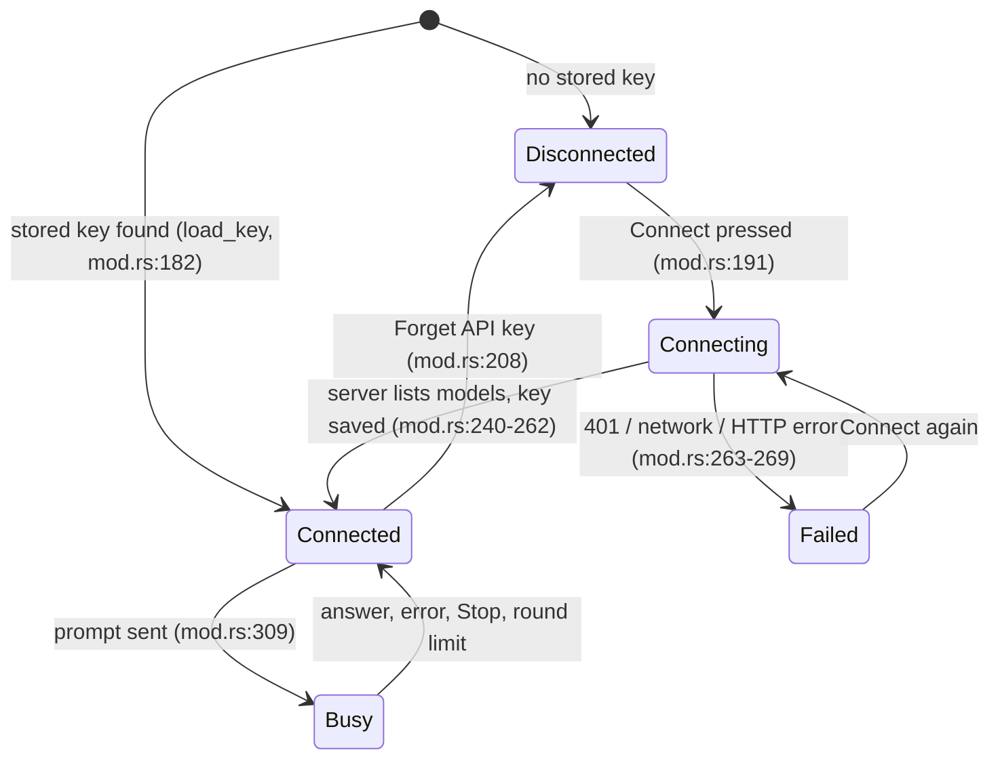
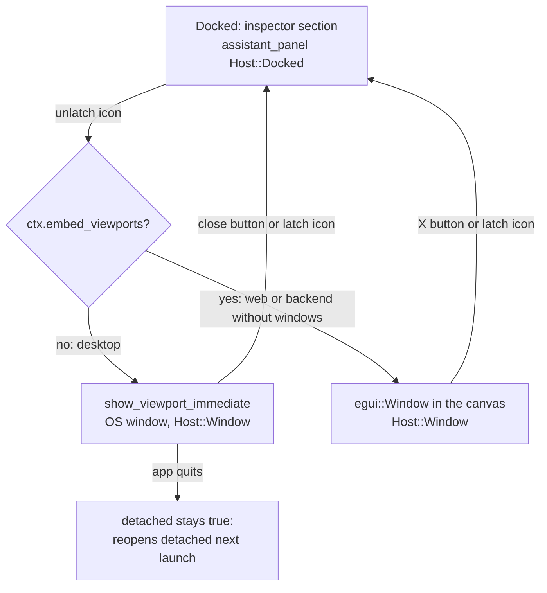

# Build with MIRA: UI and UX

[Contributor docs](README.md) · [User guide](../assistant.md) · [Architecture](architecture.md) · [Module reference](module-reference.md) · [Tools](tools.md) · [LLM protocol](llm-protocol.md)

This page describes how the panel behaves and where each behaviour lives in code. It does not repeat the user guide ([../assistant.md](../assistant.md)); read that first for the end-user view. All paths are under `crates/benchup-app/src/` unless noted. Line numbers refer to branch `feature/build-with-mira` at commit `44a7cc9`.

Items marked **(likely bug)** or listed in [Gaps / unclear](#gaps--unclear) are things I found while reading the code and could not confirm by running the app.

## 1. Where the UI code lives

| Concern | Function / type | Location |
|---|---|---|
| Whole panel body (docked or windowed) | `BenchUpApp::assistant_panel` | `assistant/panel.rs:224` |
| Header row (latch, menu, New chat, model picker) | `assistant_toolbar` | `assistant/panel.rs:256` |
| Model picker | `assistant_model_picker` | `assistant/panel.rs:331` |
| Disconnected body | `assistant_disconnected` | `assistant/panel.rs:378` |
| Connect modal | `assistant_dialogs` | `assistant/panel.rs:408` |
| Transcript + cards | `assistant_transcript`, `transcript_entry`, `change_card` | `assistant/panel.rs:514`, `:841`, `:892` |
| Composer, `@` popup, chips, Stop | `assistant_composer` | `assistant/panel.rs:578` |
| Busy banner over the viewport | `assistant_busy_banner` | `assistant/panel.rs:1002` |
| Latch/unlatch, window hosting, View menu item, shortcut | `assistant/window.rs` | whole file |
| Host enum (`Docked`, `Window`) | `Host` | `assistant/panel.rs:22` |
| Session-only UI state | `UiState` | `assistant/panel.rs:46` |
| Persisted panel state | `Preferences`, `WindowPreferences` | `assistant/mod.rs:40`, `:40` |

## 2. Panel anatomy

The panel branches on whether an API key is held in memory (`self.assistant.key.is_none()`, `assistant/panel.rs:242`), not on the `Connection` enum (`assistant/mod.rs:59-64`). `Connection::Failed` can therefore be set while the connected layout is still shown (for example a failed model reload).

### 2.1 Disconnected state

Drawn by `assistant_disconnected` (`assistant/panel.rs:378-393`), below a header that shows only the latch/unlatch icon and the weak text "Not connected" (`:305`):

1. Explainer paragraph (`assistant.explainer`).
2. If `Connection::Failed(message)`: the message in the accent colour.
3. If `ui.notice` is set (for example a key-forget error): weak text.
4. A **Connect** button, which opens the connect modal with the endpoint section collapsed (`assistant_open_connect(ctx, false)`, `:395`).

### 2.2 Connected state

Order from top to bottom (`assistant/panel.rs:241-253`): header, transcript (`assistant_transcript`), 6 px gap, composer (`assistant_composer`).

Sizing: docked transcript height is a fixed 280 px; in a window it is `available_height - 170` with a floor of 120 px (`:246-250`).

### 2.3 Header row

Items are added right to left (`assistant/panel.rs:266-307`), so left to right on screen they read: model picker, reload button, **New chat**, **⋯** menu, latch icon.

| Control | Behaviour | Code |
|---|---|---|
| Latch / unlatch icon (28×24) | Docked shows "unlatch" (tooltip `assistant.unlatch`), window shows "latch" (`assistant.latch`). Calls `assistant_set_detached`. | `:267-273`, `:308-311` |
| **⋯** menu (connected only) | "Change endpoint…" opens the connect modal with Advanced forced open; "Forget API key" calls `forget_key`. | `:274-293`, `:316-326` |
| **New chat** | Enabled only when not busy and the transcript is non-empty. Clears transcript and model-facing history (`Assistant::new_chat`, `assistant/mod.rs:189-194`). Also clears `ui.notice`. | `:294-302`, `:312-315` |
| Model picker | See [section 7](#7-model-picker-and-forget-key). | `:303`, `:331` |

### 2.4 Transcript

`assistant_transcript` (`assistant/panel.rs:514-553`) draws a framed vertical scroll area (id `assistant_transcript`) that sticks to the bottom. An empty transcript shows the hint `assistant.empty_transcript`.

Each `Entry` (`assistant/mod.rs:76`) is a rounded frame whose colours depend on `EntryRole` (`assistant/panel.rs:850-855`):

| Role | Label key | Notes |
|---|---|---|
| `User` | `assistant.you` | Text is the **rewritten** prompt, so mentions appear as `@Name [#id]` (see [section 4.4](#44-how-chips-are-rewritten)). The string pushed to the transcript is the rewritten, trimmed prompt (`assistant/mod.rs:270,294`). |
| `Assistant` | `assistant.name` | Selectable text; the model's closing sentence, or "Done." (`assistant.default_summary`, `assistant/turn.rs:302-305`) when it said nothing. |
| `Error` | `assistant.error_label` ("Problem") | Accent colours. Pushed by `record` when `result.error` is set (`assistant/mod.rs:388-390`). |

### 2.5 Change card and "Undo turn" rules

A card is attached to an `Assistant` entry when the turn created, modified, erased or joined anything (`assistant/mod.rs:359-387`). Layout (`change_card`, `assistant/panel.rs:894-984`):

* Summary line `assistant.card.summary` with four counts; ` · stopped` is appended for a Stopped turn.
* One clickable row per created, then modified, then joint id, labelled `Created · Name`, `Modified · Name`, `Joint · Name`. Clicking pushes `CardAction::Focus(id)`, which selects the entity and calls `fit_selection` (`assistant_focus_entity`, `:169-175`). A row is disabled when the entity no longer exists (`:934-944`).
* At most `CARD_ROWS = 12` rows are shown in total (`:64`), counted across all categories: created, modified and joint rows first (clickable), then erased rows as non-clickable weak text using `Changes::erased_names` (names captured from the pre-turn model, `erased_names` at `:991`), falling back to `#id`. If more rows exist than are shown, one weak line `assistant.card.more` reads "+N more", where N counts every category not shown, erased rows included (`:966`). Test `change_cards_count_every_row_they_do_not_show`.
* **Undo turn** button.

**Undo turn is enabled only when** `turn_undoable` is true (`assistant/panel.rs:988-990`): the card has a recorded `position`, that position equals the current history position, and the current position equals the number of history labels (so nothing is redoable after it). The disabled tooltip explains "Only the most recent change can be undone here. Use History for earlier ones." (`assistant.card.undo_turn_disabled`). Clicking calls the normal `undo(ctx, false)` (`:550`), so the turn can be redone. Tests: `undo_turn_is_offered_only_while_the_turn_is_the_latest_step` (`assistant/tests.rs:658`), `change_cards_list_rows_focus_entities_and_offer_undo_only_for_the_latest_turn` (`assistant/ui_tests.rs:121`).

`position` is stamped in `assistant_commit_turn` (`assistant/mod.rs:498-511`): `Some(history.position())` only if the commit really recorded a step (`commit_edit` returned `true`, `:506`).

The stamping runs only when `Assistant::record` reports that it added a change card for this turn. A turn that changed nothing adds no card, so earlier cards keep their `position` and `erased_names` and their Undo turn button (fixed; test `a_turn_without_changes_leaves_the_earlier_undo_card_intact`).

A turn whose edits were refused at commit time (shared edit access lapsed) is rolled back; it gets no card, and the transcript shows the error `assistant.error.rolled_back` instead (test `a_rolled_back_turn_does_not_claim_its_edits_on_the_change_card`).

## 3. Composer

`assistant_composer` (`assistant/panel.rs:578-793`). It is a 3-row multiline `TextEdit` (id from `COMPOSER_ID`, `:62,582`) with `lock_focus(true)`, hint `assistant.prompt_hint`.

### 3.1 Keys

| Key | Condition | Effect | Code |
|---|---|---|---|
| Enter | composer focused, `@` popup closed, not busy | Submit (`assistant_submit`) | `:650-656`, `:790-792` |
| Enter | composer focused, busy | Not consumed, so the text edit handles it (inferred: inserts a line break) | `:654` |
| Shift+Enter | composer focused, `@` popup closed | Inserts a new line (`assistant.send_help`, `docs/assistant.md`). egui's `consume_key(Modifiers::NONE, Enter)` ignores an extra Shift, so the code looks at the key event itself: `consume_plain_enter` removes only an Enter press without Shift (`:882`). Test `enter_sends_the_prompt_and_shift_enter_inserts_a_newline`. | `:654` |
| Up | text empty, `last_prompt` non-empty, popup closed | Restores the last prompt text (the raw composer text, not the rewritten one; chips are not restored) | `:658-663`, `last_prompt` set at `:199` |
| Up / Down | `@` popup open | Move highlight (wraps) | `:637-643` |
| Enter / Tab | `@` popup open | Insert the highlighted entity | `:644-648` |
| Esc | `@` popup open | Dismiss the popup for the current text (`mention_dismissed`) | `:647-649` |
| Esc | a turn is running | Stop (handled in the root keyboard handler) | `app.rs:2178-2182` |
| Ctrl/Cmd+Shift+M | anywhere | Toggle the panel ([section 10](#10-view-menu-item-and-shortcut)) | `app.rs:2175` |

Send button: `primary_button` "Send", enabled when the composer text is non-empty after trim; tooltip `assistant.send_help` (`:780-787`). Submitting first calls `assistant_cancel_interactions` (`:195`), which clears any half-finished drawing/measure/gesture state (`:209-221`) **even if the send then fails** (for example not connected).

On success the composer text and chips are cleared, the notice is cleared and focus returns to the prompt (`:197-204`). On failure the error is shown in `ui.notice` and the draft is kept (`:205`; test `send_enters_submit_and_a_blocked_send_reports_why`, `assistant/ui_tests.rs:145`). Validation order in `Assistant::send` (`assistant/mod.rs:260-283`): busy, empty prompt, invalid base URL, no key, no model.

### 3.2 Progress, elapsed time and Stop

While a turn runs the right side of the bottom row shows (`assistant/panel.rs:766-778`), right to left: **Stop** button, then the text `Working… N s` (`assistant.working`) with ` · <last tool name>` appended once any tool ran, then a spinner. `N` is `ctx time - turn.started_at` truncated to whole seconds (`:771`); tool names come from `Turn::activity` (`assistant/turn.rs:102,259`) and are the model's raw tool names, not translated. The loop repaints every 100 ms while a reply is pending (`assistant/mod.rs:313-316`).

Stop is available three ways: the button above, the button in the viewport banner (`:1013-1019`), and Esc (`app.rs:2178-2182`). All end in `Assistant::stop` (`assistant/mod.rs:321-324`) and `assistant_commit_turn`. Edits already applied are kept as one history step labelled "MIRA (stopped)" (`assistant.history_stopped`, `assistant/mod.rs:470-472`); a reply still in flight is dropped. Test: `stopping_mid_turn_commits_one_step` (`assistant/tests.rs:172`).

Other things that also stop a turn: starting a new model (`app.rs:1015`), opening/replacing a project (`projects.rs:166`). A remote replacement of a shared project discards the turn without committing (`sharing.rs:377`, `assistant/mod.rs:328-339`).

After a commit the editor selects the parts the turn created or modified (only top-level, visible ones), and applies the selection the model set with the `select` tool (`assistant/mod.rs:488-493`).

## 4. References

A "reference" attaches an object (group or component) to the prompt by its numeric id. The id is authoritative; the label is only what the designer saw (`Chip`, `assistant/panel.rs:30-33`).

### 4.1 The `@` popup

* `mention_query(text, cursor_chars)` (`assistant/panel.rs:89-100`) finds an `@` before the caret that is at the start of the text or preceded by whitespace, with no newline after it and a query of at most 40 characters. `a@b` is not a mention (test `at_mentions_are_detected_before_the_caret`, `assistant/tests.rs:558`).
* Candidates (`assistant_mention_candidates`, `:559-579`): all `model.objects` (groups and components only) whose "name + kind" matches every whitespace-separated word of the query, case-insensitively (`matches_query`, `searchable_selector.rs:29-35`); selected objects first, then by lowercase name, then id; truncated to `MENTION_LIMIT = 8` (`:63`). Each row shows the name and "group #id" / "component #id".
* The popup opens only while the composer has focus and there is at least one candidate (`:631`). Choosing a row replaces `@query` with `@Name ` in the text, adds a `Chip` if that id is not already attached, and moves the caret after the inserted text (`:719-739`). Mouse click works too (`:694-717`).
* Tags, joints, faces and edges cannot be referenced this way (only `model.objects`). The original proposal mentioned tags and joints ([development-history.md](development-history.md)); the code does not offer them.

### 4.2 Outliner drag-in (docked only)

Dragging a row from the Outliner carries an `OutlinerDrag { ids }` payload (`outliner.rs:12`, set at `outliner.rs:574`). The composer highlights its frame green while such a payload hovers and, on release, calls `assistant_add_chips(ids)` (`assistant/panel.rs:678-691,740-742`). `assistant_add_chips` skips ids that are not in `model.objects` and ids already attached (`:154-166`).

"Docked only" is a limitation recorded by the maintainers of this fork: the drag source is in the main window's sidebar, and the composer is a different OS window when the panel is unlatched on desktop. I did not find code that blocks the drop in the web floating window, and I did not verify why a cross-window drop fails; see [Gaps](#gaps--unclear).

### 4.3 "Ask MIRA about this" and the Include selection chip

* **Context menu.** The viewport/outliner context menu has a separator and an item `assistant.ask_about_this`, disabled when nothing is selected (`context_menu.rs:415-416`; test `ask_mira_is_disabled_without_a_selection`, `assistant/ui_tests.rs:60`). The action (`context_menu.rs:53-57`) adds one chip per selected id and calls `assistant_reveal`, which opens the inspector and the section (or raises the detached window), scrolls to it and focuses the prompt (`assistant/window.rs:134-145`).
* **Include selection.** A checkbox under the composer (`assistant/panel.rs:759-764`, persisted as `Preferences::include_selection`, default `true`, `assistant/mod.rs:40,40`). When on and at least one selected id is an object, a dimmed italic "Selection (N)" label is shown next to the chips (`:591-612`). The flag controls what the model gets: `Turn::start` adds the selection to the references block only when it is on, and when it is off the selection is also left out of the scene summary and `get_selection` answers with `{"selection":[],"note":"The designer has turned off sharing their selection."}` (`assistant/turn.rs:139-142`, `benchup-tools/src/ops.rs:918`). Tests: `include_selection_off_hides_the_selection_from_the_scene_and_get_selection`, `hidden_selection_is_not_revealed_by_get_scene_or_get_selection`.
* Chips whose object has since been deleted are drawn with an accent outline and strikethrough (`chip_pill`, `:811-839`); they are dropped when composing (`assistant_compose`, `:178-187`). Each pill has a "×" that removes it (`:604-606`).

### 4.4 How chips are rewritten

`rewrite_prompt(text, chips)` (`assistant/panel.rs:105-145`) runs at submit time:

1. Chips are tried longest label first, so "Leg 2" wins over "Leg".
2. An `@` at the start of the text or after whitespace is replaced with `@Label [#id]` when the text after it starts with a chip label (case-sensitive) and the next character is not alphanumeric. Each chip is used at most once; a second `@Label` stays plain text.
3. Chips never written into the text (dragged in, or from the context menu) are appended after a blank line as `Also referenced: @A [#1], @B [#2]` (`assistant.prompt.also_referenced`).
4. The returned id set is **all** chips, mentioned or not.

Tests: `chips_rewrite_the_prompt_with_ids_and_collect_references`, `a_renamed_part_still_resolves_by_id` (`assistant/tests.rs:539,567`). The ids go to `scene::references` so the model receives full details by id (`assistant/turn.rs:145`), which is why renaming a part after attaching it is harmless.

## 5. Connect modal

Built with the shared `Modal` shell (`modal.rs`), `Modal::new("assistant_connect", 460.)` (`assistant/panel.rs:423`). Rendered by whichever window hosts the panel (`assistant_dialogs` is called from `assistant_window`: `assistant/window.rs:189-196` docked, `:259` inside the native window, `:198` for the embedded window).

| Element | Detail | Code |
|---|---|---|
| Title / subtitle | `assistant.connect_title` ("Connect to endlesstokens"), `assistant.connect_subtitle` | `:424-427` |
| API key | Password-masked single-line edit, hint `assistant.api_key_hint`. Auto-focused while empty and not yet submitted. Enter in the field connects. | `:429-441` |
| Get a key | Hyperlink to `client::KEY_PORTAL_URL` = `https://portal.endlesstokens.ai/key` | `:442`, `assistant/client.rs:10` |
| Advanced | `CollapsingHeader` whose open state is remembered under the stable key `assistant_connect_advanced` (default closed) via `restored_header_open` / `remember_section` (AGENTS.md persistence rule). "Change endpoint…" forces it open. | `:65,443-465,401-403` |
| Server address | Single line, hint `DEFAULT_BASE_URL` = `https://api.endlesstokens.ai/v1` | `:448-453`, `assistant/client.rs:9` |
| Status | Spinner + "Checking your key…" while connecting; the server error (accent) after a failed attempt | `:466-474` |

**Validation.** The server address is normalised (`normalize_base`: trim, strip trailing `/`) and must pass `valid_base_url` (`assistant/panel.rs:422`): `https://` with a non-empty host, or `http://` only for `localhost` / `127.0.0.1` (optionally with a port); no `?`, `#`, `@` or spaces (`assistant/client.rs:26-39`). An invalid address shows `assistant.error.invalid_server_address` and disables **Connect** (`:454-463,476`). **Connect** is also disabled while a check is running. An empty key is rejected by `Assistant::connect` with `assistant.error.invalid_api_key` (`assistant/mod.rs:157-169`).

**Footer order.** AGENTS.md "Modal actions" says the least impactful action goes on the right and the footer renders right to left, so actions are declared from least to most impactful. The code declares **Cancel** first, then **Connect** (`assistant/panel.rs:476-481`), so on screen it reads Connect, Cancel. The test `connect_dialog_declares_cancel_before_connect_so_cancel_renders_on_the_right` (`assistant/ui_tests.rs:69`) measures the x positions.

**Behaviour on Connect** (`assistant/panel.rs:483-500`):

1. If the address differs from `settings.base_url`, it is **not** saved yet. `Assistant::connect_to` sends `GET {base}/models` to the new address with the typed key (or the key already stored for that address) and keeps the address in `pending_base`. Only when the server accepts the key are the address, the key and the model list adopted, the model reset so a default is chosen, and the key saved under the new address. A rejected key or a network failure leaves the old address, key and model list untouched (test `a_new_server_address_is_kept_only_after_a_successful_connect`).
2. If the key field is empty and a key is already stored for that address, the model list is just refreshed and the dialog closes (`:492-495`).
3. Otherwise (same address) `Assistant::connect` sends `GET {base}/models` with the key; the dialog stays open showing progress until the reply (`dialog.submitted = true`). On success the dialog closes (`:413-415`) and the key is saved ([persistence-and-security.md](persistence-and-security.md#5-api-key-storage)).

**Cancel / close** (`:501-510`): if the connection state is `Failed`, it reverts to `Connected` when a key is held, else `Disconnected`. Test: `connecting_saves_a_valid_key_and_rejects_an_invalid_one` (`assistant/tests.rs:308`).

## 6. Privacy notice

Under the composer, until dismissed, a wrapped weak line `assistant.privacy` shows "A summary of your model (names and dimensions) is sent to {host}." with a small **Don't show again** button (`assistant/panel.rs:744-755`). `{host}` is `host_of(base_url)`: scheme and path removed, port kept (`:78-86`). Dismissal sets `Preferences::privacy_dismissed` and is persisted. The notice is only drawn in the connected layout (it lives in the composer). What is actually sent is listed in [persistence-and-security.md](persistence-and-security.md#6-privacy-what-leaves-the-machine); it includes more than names and dimensions (positions, tags, joints, materials).

## 7. Model picker and Forget key

**Picker** (`assistant_model_picker`, `assistant/panel.rs:331-376`): a `SearchableSelector` (id `assistant_model`) listing `Assistant::models`, with the placeholder "Choose a model" when none is set. Whatever the user types that is not in the list appears as an always-visible choice `Use "text"` (`:340-345`), so a model id the server does not list can be selected. Changes are ignored while a turn is running (`:367`). A ⟳ button (disabled while connecting) calls `refresh_models` (`:353-359,373-375`). The chosen name is stored in `Preferences::model`.

* Default choice: after a successful model list, if **no model is chosen yet** (the setting is empty), the first id containing `qwen` (case-insensitive, `DEFAULT_MODEL_HINT`, `assistant/mod.rs:34`) is selected, else the first id (`:276-283`).
* A model the user picked or typed (`Use "..."`) is kept when the list is reloaded or the app restarts, even if the server's list omits it (fixed; test `a_typed_model_survives_a_model_list_that_omits_it`). Switching to a different server resets the model so a default is chosen for it.

**Forget API key** (⋯ menu, `assistant/panel.rs:289-292,316-323`): `Assistant::forget_key` (`assistant/mod.rs:182-188`) clears the in-memory key and model list, sets `Disconnected`, and deletes the key stored for the **current** server address (`credentials::forget`). The panel returns to the disconnected layout; the transcript, history and model name are kept. A deletion error is shown as the notice. Keys stored for other addresses are not touched. See [persistence-and-security.md](persistence-and-security.md#5-api-key-storage).

## 8. Latch and unlatch

"Latched" means the panel is the last inspector section (`InspectorSection::Assistant`, `sidebar.rs:831`). "Unlatched" is `Preferences.window.detached == true`.

`assistant_window` runs once per frame after the busy banner (`app.rs:6485-6486`; `assistant/window.rs:189-207`). Docked, it only runs the dialogs and resets geometry tracking.

### 8.1 Native window

`assistant_native_window` (`assistant/window.rs:236-291`) opens an **immediate viewport** (`ctx.show_viewport_immediate`, id from `viewport_id()` = hash of `"benchup.assistant"`, `:31-33,251`). Immediate viewports run the callback inline, which is what lets the panel borrow `&mut self` (module comment, `:3-5`). The window has title "Build with MIRA", inner size from the saved size (default `DEFAULT_SIZE` 440×640) and minimum `MIN_SIZE` 340×300 (`:16-17`), and its content is the same `assistant_panel` with `Host::Window` inside a `CentralPanel` (`:252-258`). The connect modal is drawn inside it (`:257`).

### 8.2 Web / embedded window

`assistant_embedded_window` (`assistant/window.rs:209-233`) uses `egui::Window` (not collapsible, resizable, default size from prefs, minimum `MIN_SIZE`). It is chosen whenever `ctx.embed_viewports()` is true, which includes the browser. Start position: the saved position if it lies inside the screen shrunk by 8 px, else the top-right corner minus the window width and 24 px, 96 px down (`:210-215`). Closing it with its X latches back (`:223-225`).

### 8.3 Placement persistence and debounce

`track_geometry` (`assistant/window.rs:293-312`) runs each frame while the window is visible with the window's position (native: outer corner; embedded: top-left of the window rect) and size (native: inner size). The rectangle must be unchanged for `SETTLE_SECONDS = 0.4` before it is copied into `settings.window.position/size`; while it is still moving a repaint is requested after 500 ms. Dragging therefore does not rewrite preferences every frame. Persisting to storage happens through `persist_inspector_changes` ([persistence-and-security.md](persistence-and-security.md#2-what-is-persisted)). Test: `detached_panel_state_follows_latch_calls_and_is_debounced` (`assistant/tests.rs:509`).

### 8.4 Off-screen heuristic

egui exposes only the monitor under a window, so a saved position cannot be checked against the real monitor list. `position_usable` (`assistant/window.rs:50-68`) accepts a position when all numbers are finite, no coordinate has magnitude above 30 000, and (when the main window rect and monitor size are known) the window rectangle intersects the main window's outer rect expanded by 2.5× the larger of the monitor size and 800×600 in each direction. If not usable, the window opens at `default_position` = main window right edge minus width minus 48 px, 96 px below the main window top (`:72-76`). On the third frame the window also moves to that position if the OS reports no monitor or a zero-size monitor (`:268-275`).

Limits: a monitor that was unplugged but whose area lies within that margin (for example a second monitor placed beside the main one) is **not** detected; the check cannot know what is currently connected. Tests: `offscreen_positions_are_rejected_near_main_window_is_used` (`assistant/tests.rs:495`), `saved_window_geometry_is_sanitized_and_old_saves_default` (`:477`).

### 8.5 Close and quit

* Closing the detached OS window sets `latch` from `close_requested()` and calls `assistant_set_detached(false)` unless the **root** window is also closing (`assistant/window.rs:236-241,288,287-289`). Quitting the app therefore leaves `detached == true`, and the panel reopens detached at the next launch (test `window_privacy_and_selection_preferences_persist_without_a_model_edit`, `assistant/tests.rs:449`).
* Latching back (`assistant_set_detached(ctx, false)`, `window.rs:102-114`) turns the inspector on, opens the section, resets geometry tracking and focuses the prompt. The remembered position and size are kept for next time.

### 8.6 Docked placeholder

When detached, the inspector section shows `assistant.detached_window` ("Build with MIRA is open in a separate window.") or, if `embed_viewports()`, `assistant.detached_floating`, plus **Latch back** and **Bring to front** (`assistant/window.rs:80-99`). **Bring to front** sends `ViewportCommand::Focus` for the native window; for the embedded window it calls `ctx.move_to_top(embedded_layer())` so the `egui::Window` layer is raised above other layers (`:116-125`), and the callers set `focus_prompt` so the prompt gets keyboard focus. Test `bring_to_front_raises_the_embedded_window_layer`.

### 8.7 Visibility rules

* `assistant_visible`: detached, or the inspector is shown and the `assistant` section is open (`:128-132`).
* `assistant_reveal`: detached raises the window; docked turns the inspector on, opens the section, scrolls to it and focuses the prompt (`:134-145`).
* `assistant_toggle`: detached raises (it never hides); docked and visible collapses the section; otherwise reveals (`:147-157`).

## 9. Busy gate

While `Assistant::busy()` (a `Turn` exists, `assistant/mod.rs:139-141`) the editor protects the model from interleaved user edits.

| Area | What happens | Code |
|---|---|---|
| Edits that go through `finish_edit` | The model is restored to its pre-edit state and the notice `assistant.busy_blocked` is shown ("MIRA is editing the model. Wait for it to finish or press Stop.") | `app.rs:772-792` |
| Undo / redo / History clicks | Refused with the same notice | `app.rs:834` |
| Keyboard shortcuts | The handler returns early; only Esc (Stop) and the MIRA toggle shortcut work | `app.rs:2175-2184` |
| Viewport primary-button gestures | Skipped unless the tool is Select or Orbit; middle/right buttons and context menu handling are unchanged | `app.rs:4531-4537` |
| Sending another prompt | `assistant.error.busy`; Enter does nothing; the Send button is replaced by Stop | `assistant/mod.rs:271-273`, `assistant/panel.rs:654,766` |
| Model picker, New chat | Picker changes ignored; New chat disabled | `assistant/panel.rs:370,296` |
| New model / open project | The turn is stopped first | `app.rs:1015`, `projects.rs:166` |
| Still allowed | Orbit, pan, zoom, selecting, scrolling the transcript, Stop, toggling the panel, latching/unlatching | `app.rs:4531` |

The commit at the end of a turn is never refused by this gate because the `Turn` is dropped before `finish_edit` runs (`app.rs:781-785`, `assistant/mod.rs:458-476`).

**Viewport banner** (`assistant_busy_banner`, `assistant/panel.rs:1002-1024`): an egui popup-styled `Area` pinned 12 px below the top-centre of the viewport rectangle (`self.viewport.center_top()`), foreground order, with a spinner, `assistant.banner` ("MIRA is editing…") and a **Stop** button. It is an egui overlay, not scene geometry, and is drawn in the main window only.

Not covered: inspector widgets are not disabled; their edits are only refused if they flow through `finish_edit`. See [roadmap.md](roadmap.md).

## 10. View menu item and shortcut

* **View menu.** `assistant_view_menu_item` adds an item labelled "Build with MIRA" with the `assistant` icon and the formatted shortcut text, hover text `assistant.menu_help`; clicking toggles the panel (`assistant/window.rs:175-187`). It is inserted after the separator at the end of the View menu, before the Sections submenu (`sidebar.rs:4913`).
* **Shortcut.** Ctrl+Shift+<key> (Cmd+Shift on macOS), default `M` (`GeneralSettings::assistant_key`, `settings.rs:162,187`; `assistant_shortcut`, `assistant/window.rs:159-162`). Handled by `assistant_toggle_shortcut` (`:165-172`) at `app.rs:2175`, after the "project blocked / screenshot open" guard and before the busy check, so it works while MIRA is busy.
* **Remapping.** Settings → Shortcuts has a row (`settings.rs:581-608`) using the shared `shortcut_input`. It is listed in the shortcuts help (`shortcuts.rs:94-97,286`). Test: `shortcut_is_cmd_shift_m_by_default_and_toggles_the_panel` (`assistant/ui_tests.rs:160`).
* **Reserved-key rule.** Egui matches `Cmd+Shift+<key>` also for commands defined without Shift (extra Shift is ignored), so MIRA may not use the letters of existing Ctrl/Cmd commands: `A C F N O S V X Y Z` and `Space` (`GeneralSettings::RESERVED_ASSISTANT_KEYS`, `settings.rs:238`; `assistant_key_allowed`, `:227-229`). Valid keys are `A`-`Z` (upper case) or `Space` (`shortcut_input.rs:6-8`) minus that list, which leaves `B D E G H I J K L M P Q R T U W`. A rejected key shows `assistant.shortcut_reserved` and is not saved (`settings.rs:585-604`); a saved reserved key falls back to `M` when settings are normalised (`settings.rs:221-223`). Test: `assistant_shortcut_keys_cannot_collide_with_ctrl_shift_commands` (`assistant/ui_tests.rs:244`).

## 11. Icons

Two line icons were added in `icons.rs`: `assistant` (speech bubble with a spark, `icons.rs:1485`) and `latch`/`unlatch` (window with an arrow in or out, `icons.rs:1500`). The sidebar section colour for `assistant` is set at `sidebar.rs:4181`.

## 12. i18n keys added by the feature

All user-facing text uses `tr!` keys in `assets/i18n/en.json` (English only, per AGENTS.md "Application language"). Computed with `git diff 64b2a44..HEAD -- assets/i18n/en.json`: **86 keys**, all under `assistant.`, none removed. The existing `common.cancel` is reused for the Cancel button (`assistant/panel.rs:478`). "Used at" lists up to three non-test call sites found by searching for the quoted key (only the first three are shown).

| Key | English text | Used at |
|---|---|---|
| `assistant.name` | Build with MIRA | `shortcuts.rs:286`, `sidebar.rs:4033`, `settings.rs:581` |
| `assistant.default_summary` | Done. | `assistant/turn.rs:304` |
| `assistant.history_label` | MIRA: {summary} | `assistant/mod.rs:474` |
| `assistant.history_stopped` | MIRA (stopped) | `assistant/mod.rs:471` |
| `assistant.error.invalid_server_address` | The assistant server address must use https, or http on localhost. | `assistant/client.rs:55`, `assistant/panel.rs:458` |
| `assistant.error.invalid_api_key` | Invalid API key | `assistant/client.rs:56`, `assistant/mod.rs:167` |
| `assistant.error.tools_unsupported` | This model doesn't support tool calls. Pick another model. | `assistant/client.rs:57` |
| `assistant.error.network` | Cannot reach the assistant server: {e} | `assistant/client.rs:58` |
| `assistant.error.cannot_reach_server` | Cannot reach the assistant server | `assistant/client.rs:341` |
| `assistant.error.http` | The assistant server returned an error ({status}): {message} | `assistant/client.rs:60` |
| `assistant.error.bad_response` | Unexpected response from the assistant server: {e} | `assistant/client.rs:62` |
| `assistant.error.no_model_list` | The server did not return a model list | `assistant/client.rs:211` |
| `assistant.error.no_choices` | The server returned no answer | `assistant/client.rs:226` |
| `assistant.error.interrupted` | The request was interrupted | `assistant/turn.rs:207`, `assistant/mod.rs:201` |
| `assistant.error.round_limit` | MIRA stopped after {count} steps without finishing. Ask for the remaining work in a new message. | `assistant/turn.rs:276` |
| `assistant.error.busy` | MIRA is still working on the previous request | `assistant/mod.rs:272` |
| `assistant.error.rolled_back` | MIRA's changes were rolled back because you no longer have edit access to this shared project. | `assistant/mod.rs:482` |
| `assistant.error.shared_changed` | The shared project changed; MIRA stopped | `sharing.rs:376` |
| `assistant.error.empty_prompt` | Type what you want to build or change | `assistant/mod.rs:275` |
| `assistant.error.not_connected` | Connect to the assistant server with an API key first | `assistant/mod.rs:280` |
| `assistant.error.no_model` | Choose a model first | `assistant/mod.rs:282` |
| `assistant.error.no_browser` | No browser is available | `assistant/credentials.rs:79` |
| `assistant.error.storage_unavailable` | Browser storage is unavailable | `assistant/credentials.rs:81`, `assistant/credentials.rs:82` |
| `assistant.error.cannot_save_key` | Cannot save the API key in this browser | `assistant/credentials.rs:95`, `assistant/credentials.rs:101` |
| `assistant.error.cannot_save_key_detail` | Connected, but the API key could not be saved on this device: {e} | `assistant/mod.rs:231` |
| `assistant.advanced` | Advanced | `assistant/panel.rs:444` |
| `assistant.api_key` | API key | `assistant/panel.rs:429` |
| `assistant.api_key_hint` | Paste your API key | `assistant/panel.rs:433` |
| `assistant.ask_about_this` | Ask MIRA about this | `context_menu.rs:416` |
| `assistant.banner` | MIRA is editing… | `assistant/panel.rs:1016` |
| `assistant.base_url` | Server address | `assistant/panel.rs:448` |
| `assistant.bring_to_front` | Bring to front | `assistant/window.rs:96` |
| `assistant.busy_blocked` | MIRA is editing the model. Wait for it to finish or press Stop. | `app.rs:783`, `app.rs:834` |
| `assistant.card.created` | Created | `assistant/panel.rs:925` |
| `assistant.card.erased` | Erased | `assistant/panel.rs:964` |
| `assistant.card.joint` | Joint | `assistant/panel.rs:927` |
| `assistant.card.modified` | Modified | `assistant/panel.rs:926` |
| `assistant.card.more` | +{count} more | `assistant/panel.rs:968` |
| `assistant.card.row_help` | Select this {kind} and zoom to it | `assistant/panel.rs:949` |
| `assistant.card.stopped` | stopped | `assistant/panel.rs:919` |
| `assistant.card.summary` | Created {created} · Modified {modified} · Erased {erased} · Joints {joints} | `assistant/panel.rs:912` |
| `assistant.card.undo_turn` | Undo turn | `assistant/panel.rs:973` |
| `assistant.card.undo_turn_disabled` | Only the most recent change can be undone here. Use History for earlier ones. | `assistant/panel.rs:977` |
| `assistant.card.undo_turn_help` | Undo everything MIRA changed in this turn | `assistant/panel.rs:975` |
| `assistant.change_endpoint` | Change endpoint… | `assistant/panel.rs:285` |
| `assistant.choose_model` | Choose a model | `assistant/panel.rs:348` |
| `assistant.connect` | Connect | `assistant/panel.rs:390`, `assistant/panel.rs:480` |
| `assistant.connect_subtitle` | Your key is stored only on this device. | `assistant/panel.rs:426` |
| `assistant.connect_title` | Connect to endlesstokens | `assistant/panel.rs:425` |
| `assistant.connecting` | Checking your key… | `assistant/panel.rs:469` |
| `assistant.detached_floating` | Build with MIRA is open in a floating window. | `assistant/window.rs:87` |
| `assistant.detached_window` | Build with MIRA is open in a separate window. | `assistant/window.rs:89` |
| `assistant.dont_show_again` | Don't show again | `assistant/panel.rs:751` |
| `assistant.empty_transcript` | Describe what you want to build or change. Type @ to refer to a part of your design. | `assistant/panel.rs:537` |
| `assistant.error_label` | Problem | `assistant/panel.rs:866` |
| `assistant.explainer` | Describe a change in plain language and MIRA builds it in your model. Each request is one undo step. Connect an API key to start. | `assistant/panel.rs:380` |
| `assistant.forget_key` | Forget API key | `assistant/panel.rs:289` |
| `assistant.get_a_key` | Get a key | `assistant/panel.rs:442` |
| `assistant.include_selection` | Include selection | `assistant/panel.rs:762` |
| `assistant.include_selection_help` | Send the objects you have selected along with your request | `assistant/panel.rs:764` |
| `assistant.kind_component` | component | `assistant/panel.rs:564` |
| `assistant.kind_group` | group | `assistant/panel.rs:563` |
| `assistant.latch` | Latch back into the sidebar | `assistant/panel.rs:269` |
| `assistant.latch_back` | Latch back | `assistant/window.rs:93` |
| `assistant.menu_help` | Show or hide the Build with MIRA assistant | `assistant/window.rs:182` |
| `assistant.more` | More | `assistant/panel.rs:280` |
| `assistant.new_chat` | New chat | `assistant/panel.rs:297` |
| `assistant.no_models_match` | No models match your search | `assistant/panel.rs:367` |
| `assistant.not_connected` | Not connected | `assistant/panel.rs:305` |
| `assistant.privacy` | A summary of your model (names and dimensions) is sent to {host}. | `assistant/panel.rs:748` |
| `assistant.prompt.also_referenced` | Also referenced: {list} | `assistant/panel.rs:142` |
| `assistant.prompt_hint` | What should MIRA build or change? Type @ to refer to a part. | `assistant/panel.rs:671` |
| `assistant.reload_models` | Reload the model list | `assistant/panel.rs:358` |
| `assistant.remove_reference` | Remove this reference | `assistant/panel.rs:831` |
| `assistant.search_models` | Search or type a model | `assistant/panel.rs:366` |
| `assistant.selection_chip` | Selection ({count}) | `assistant/panel.rs:606` |
| `assistant.selection_chip_help` | Your current selection is sent with the request | `assistant/panel.rs:611` |
| `assistant.send` | Send | `assistant/panel.rs:781` |
| `assistant.send_help` | Send (Enter). Shift+Enter adds a new line. | `assistant/panel.rs:782` |
| `assistant.shortcut_label` | {name} ({modifier} + key) | `settings.rs:589` |
| `assistant.shortcut_reserved` | {key} is already used by another Ctrl/Cmd+Shift shortcut. Choose a different key. | `settings.rs:591` |
| `assistant.stop` | Stop | `assistant/panel.rs:767`, `assistant/panel.rs:1017` |
| `assistant.unlatch` | Open in a separate window | `assistant/panel.rs:268` |
| `assistant.use_model` | Use "{model}" | `assistant/panel.rs:342` |
| `assistant.working` | Working… {seconds} s | `assistant/panel.rs:772` |
| `assistant.you` | You | `assistant/panel.rs:864` |

Notes: `assistant.error.cannot_save_key` / `assistant.error.no_browser` / `assistant.error.storage_unavailable` are used only in the wasm build of `credentials.rs`. Templates use named placeholders such as `{host}`, `{count}`, `{e}`.

## Gaps / unclear

Fixed in the commit "Fix issues found while documenting MIRA": Shift+Enter submitting, the lost Undo turn after a no-change turn, a typed model being replaced on reload, Bring to front on the web, and erased rows missing from the "+N more" count. Still open or unverified:

1. **Why drag-in works only when docked.** The code does not check the host; the cause is presumed to be egui's drag payload being per window. Not verified, and the web floating window was not tried.
2. **Esc in the detached window.** The Esc-to-stop handler is in the root window's keyboard handler (`app.rs:2180`). The user guide says Esc stops a request ([../assistant.md](../assistant.md)); I did not verify it works while the detached window has focus. The guide also says typing in the detached window never triggers editor shortcuts; the mechanism (separate viewport input) is assumed, not asserted in code.
3. **Privacy notice wording** says "names and dimensions" while the summary also carries positions, tags, joints and materials.
4. **Native window on a real second monitor** was never exercised by a human or a test; only the pure functions are tested. See [roadmap.md](roadmap.md).
5. **Keys rendered by the OS** (key chord text, window titles) were not verified on Windows or Linux.
